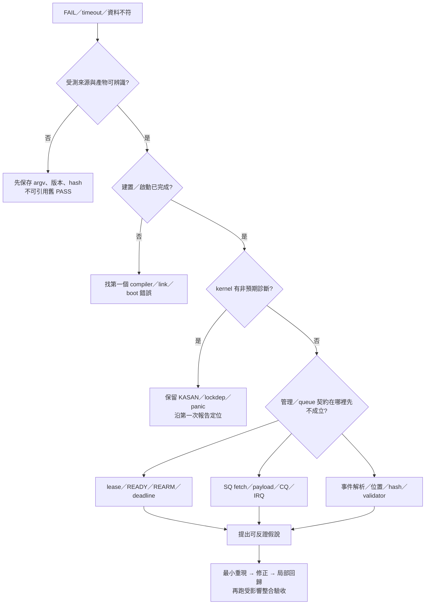

# BUG 定位、反證與修正

本章把「結果不符預期」拆成可檢查的條件。命令均在 L1 WSL 的專案根目錄執行，
除非段落另有標示。歷史已發生問題見 [BUG_LOG](BUG_LOG.md)；本章的假說表和練習是排查方法，
不代表列出的每一種故障都已在本專案發生。測試結果的版本與範圍見 [VALIDATION](VALIDATION.md)。

完成本章後，應能從一個 FAIL 找到最先失去的契約、提出至少兩個可區分的原因，
再用原始記錄與最小回歸檢查修正。先讀 [系統分析](SYSTEM_ANALYSIS_ZH.md) 的三種狀態，
追函式時搭配 [TRACE CODE](TRACE_CODE_ZH.md)。

## 1. 先確認失敗屬於哪一層

同樣是「沒收到 completion」，可能是 owner 沒提交、QEMU 沒 fetch、payload fault、CQ fault、
IRQ 未通知，或 tenant 讀取了錯誤的 phase。錯誤訊息中的最後一個 timeout 通常只描述等待結束，
不必然是最初的錯誤。



一開始保留下面五項：觸發命令、實際輸入、預期不變條件、第一次偏離預期的位置，以及完整結果目錄。
不要在保存前執行 `make clean-build`；清除 build 會移除分析受測 binary 的機會。

## 2. 從 latest pointer 走到原始資料

`*-latest.json` 是索引，不是完整證據；新一輪執行會更新它。
以下先找最後一次 individual M3 VM 的目錄，保存到目前 shell 的變數。
如果尚未執行該類 VM，檔案不存在是合理結果，應先完成建置與對應驗證。

```sh
LAB_RUN=$(python3 - <<'PY'
import json
from pathlib import Path
pointer = json.loads(Path('artifacts/m3-case-latest.json').read_text())
print(pointer['path'])
PY
)
printf '%s\n' "$LAB_RUN"
python3 -m json.tool "$LAB_RUN/result.json"
python3 -m json.tool "$LAB_RUN/command.json"
```

先核對 `result.json` 的 `cases` 中 `id`／`scenario`、頂層 `profile`／`status`，
以及失敗時的 `error` 與受測產物，再看 logs。
這裡只讀檔；不把 pointer 的 PASS 等同完整 M3 PASS。單一 T03／T05／T08 的 wrapper
也會保存自己的結果，需沿其 `path`／`variants` 走到實際 VM 記錄。

| 檔案 | 回答的問題 | 容易誤讀的地方 |
|---|---|---|
| `command.json` | QEMU 實際 argv、cwd 是什麼？ | 文件上的範例命令不一定等於該次實跑 |
| `result.json` | runner／validator 拒絕哪個條件？ | guest 印 PASS 後，host 仍可能拒絕 |
| `serial.log` | userspace 結構化事件、owner／control 時序 | 一行事件要有有效 JSON；不能拼修受損行 |
| `kernel.log` | driver 與 kernel 診斷 | UART 分流後仍必須檢查；不可只讀 serial |
| `qemu.log` | requester、DMA、generation、fault callback | `TOY_DMA_OK` 每配置僅記各 role 首筆成功，不是逐 request 完整 trace |
| `m3-barriers.json` | fault 是否設定並收到 ACK？ | 送出設定不等於裝置已接受 |
| 衍生 evidence JSON | validator 如何整理原始資料？ | 衍生檔必須與 raw logs 重新推導結果一致 |

若 report 有 `evidence_hashes`，先確認原始檔未在執行後改變：

```sh
python3 - "$LAB_RUN" <<'PY'
import hashlib
import json
import sys
from pathlib import Path
directory = Path(sys.argv[1])
report = json.loads((directory / 'result.json').read_text())
hashes = report.get('evidence_hashes')
if not hashes:
    raise SystemExit('此結果沒有 evidence_hashes；須查看其 wrapper 與生成階段')
for name, expected in hashes.items():
    actual = hashlib.sha256((directory / name).read_bytes()).hexdigest()
    if actual != expected:
        raise SystemExit('HASH MISMATCH: ' + name)
print('保存的 evidence hashes 一致；尚未執行語意重驗')
PY
```

Hash 相同只能支持「現在的 bytes 與記錄時相同」，不能支持「測試方法正確」或「受測輸入足夠」。
來源與 binary 的綁定方式見 B009、B017；請使用既有 verifier 的重驗流程，不手動改 stamp 來接受舊結果。

## 3. 先排來源、編譯、啟動問題

```sh
git status --short
git rev-parse HEAD
make env-check
rg -n -m 12 'error:|undefined reference|fatal error:|FAILED:|No rule to make target' artifacts/build-*/
```

最後一行是跨建置紀錄搜尋索引，會同時命中歷史失敗；必須回到本次結果指向的 log 核對。
不要僅看最末尾的 `make: Error 2`，它是上層傳遞的退出狀態。往前找第一個出錯的 compile／link argv，
確認它使用的 compiler、C dialect、include、目標架構和連結單元。

| 症狀 | 先驗證的原因 | 具體反證 |
|---|---|---|
| `bool`／`false` 宣告編譯錯誤 | EFI stub 的 C dialect 與 compiler 組合 | 查看實際 `CC`／`HOSTCC`，對照 B011；不能以系統預設 gcc 版本代替 argv |
| `undefined reference to fw_zero` | harness 漏連 portable core 單元 | 確認 link argv 是否含所需 `.c`／object；B007 不是 parser runtime fault |
| NASM operand 錯誤 | assembler 與 pinned EDK2 語法不相容 | 比對 locked patch bytes、套用目標與 B012，不能忽略 assembler exit code |
| 驗證說來源不符 | 允許檔案內混入額外修改、HEAD 不同 | 使用來源驗證器；reverse apply 成功不足以反證 B009 |
| 模組載入卻沒有 control node | probe 失敗或 unwind 正確撤回註冊 | 查看 kernel probe error、PCI binding 與 T02 failpoint；insmod 成功只證明 module init 返回成功 |

這些分類決定下一步的工作層：compiler 問題在 L1；PCI binding 與 driver probe 在 L2；
裝置 MMIO callback 在 L1 的 QEMU process。先辨認層級，才決定要讀哪個 binary 的符號。

## 4. 沒收到 completion：沿資料發布順序定位

先用既有紀錄做索引，不先新增大量 printf：

```sh
rg -n 'OWNER_WORKLOAD|M3_CONTROL|RECOVERY_|OWNER_MAP|OWNER_UNMAP' "$LAB_RUN/serial.log"
rg -n 'TOY_DMA_OK|TOY_DMA_ERROR|TOY_PENDING|TOY_STALE_CPL|TOY_FAULT|TOY_CORE' "$LAB_RUN/qemu.log"
rg -n 'KASAN:|BUG:|WARNING:|Oops:|Kernel panic|lockdep' "$LAB_RUN/kernel.log"
rg -n 'service_one|toy_complete|same_generation|static bool gate' device/toy_hw.c
rg -n 'owner_workload|__ATOMIC_ACQUIRE|CQ_HEAD|SQ_TAIL|DOORBELL' guest/tenant/owner.c guest/common/lab_ring.h
```

最後兩行用來找原始碼入口；符號搜尋沒有輸出時，先確認命名與檔案，不能推論該邏輯沒有實作。

| 最後確認的進度 | 下一個要觀察的條件 | 能區分的原因 |
|---|---|---|
| lease 已取得 | owner 的 MAP、CONFIG_COMMIT、READY tuple、REARM 回覆 | 管理已准入，但 queue 尚未開啟 |
| SQ tail 已前進 | gate、CQ capacity、`pending.valid`、SQ head | 尚未 fetch，或先被 backpressure 擋住 |
| SQ head 已前進 | descriptor epoch、STALE_DESC、decode status | 被消費不表示會產生 completion；舊 epoch 特別不寫 CQ |
| payload DMA 成功 | CQ body／phase 寫入結果 | payload 成功後仍可能在 CQ 寫入失敗 |
| CQ phase 已發布 | tenant 預期 phase、CQ id／epoch、CQ_HEAD | consumer 用錯圈數或定位錯 slot |
| CQ 有有效 entry | MSI-X 註冊、cause、eventfd、poll 讀取 | 資料已發布，但通知或等待路徑有問題 |

`service_one()` 在 fetch 後先增加 SQ head，再檢查 descriptor epoch。舊 epoch 的路徑增加 STALE_DESC
並返回，不產生 CQ。這是設計行為；若後續正常工作仍假設 SQ／CQ cursor 相同，就會重現 B018 類型的錯誤。

若 CQ 已正確發布，eventfd 沒有新的數值也不能直接判定資料遺失；IRQ 可被遮罩或合併。
反過來，讀到 eventfd 也不能認定某個 CQ entry 已有效。通知與資料驗證是兩個觀測點。

## 5. DMA fault：把位址、權限、身分分開查

一次 mapping 成功不代表所有方向都可用。SQ 要裝置 READ，CQ 要裝置 WRITE；payload 方向由 opcode 決定。
除三者的 IOVA 範圍外，還需檢查 length、跨頁 chunk、映射所屬 domain 和實際 requester。

| 假說 | 支持它的觀測 | 會推翻它的觀測 |
|---|---|---|
| payload 沒有 MAP | OWNER_MAP 缺對應 kind／範圍；該 payload DMA fault | 完整 MAP 且 payload 同方向成功，需要再查其後步驟 |
| DMA 使用錯 requester | trace RID 與該 VF BDF 不符 | 由實際 helper 對同一 VF 記錄的 RID 相符；再查 domain／權限 |
| buffer 長度跨出 mapping | fault address／chunk 碰到界外，SQ 輸入能推得同一範圍 | 全部 chunks 皆在 mapped extent 內；再查方向與世代 |
| WRITE-only 沒禁止 READ | READ 實際成功且無 fault，requested flags 卻只列 WRITE | strict toy 模式下實際 READ fault；不能僅用 requested flags 判斷 |
| payload 正常，CQ 不可寫 | payload 成功，CQ role fault；phase 未發布 | CQ body／phase 均成功，問題轉往 consumer／IRQ |

B002 的重點是「要求的權限」與「平台真正實現的權限」要分開驗證。
T05 strict WRITE-only 使用明列、預設關閉、限制 toy VF 的 kernel patch；
不可將客製模式的結果套用到 stock Linux。

發生 fault 時還要檢查健康 VF 的整個 buffer 與進度；只有出錯 VF 自己的 errno，不能支持跨 VF 隔離結論。

## 6. Reset 後掛住：用 tuple 和期限分段

先依相同 VF 和 session，按每個 raw stream 自己的順序排列：
舊 epoch → pending → STOP_REQUEST → PF FENCE（換 epoch）→ 核對 STOPPED → RESET →
RECOVERING／RESET_NOTICE → exact UNMAP → fresh CONFIG → READY → REARM。
新 epoch 在 FENCE 時建立，RESET 不再另換一次 epoch。
不同 log 使用的時鐘可能不同，不能直接排序時間戳就聲稱得到全域時序；以 checkpoint／ACK 夾住跨層區間。

| 現象 | 檢查點 | 不應採取的捷徑 |
|---|---|---|
| 一直 RECOVERING | 新 CONFIG 與 ready_gen 是否存在？READY 是否仍帶舊 epoch？ | 直接寫 ACTIVE 或略過 REARM guard |
| READY 回覆前就 KILLED | logical deadline 與 first/last virtual ticks；是否串行等待其他 owner？ | 先延長 timeout，掩蓋 B001 的錯誤順序 |
| reset 完成但舊資料變動 | callback old/live tuple、STALE_CPL、新舊 guards、IRQ | 只看 cancel counter 或只禁止測試 callback 執行 |
| cleanup 後仍 reserve | owner 是否已 closed、PCI/config/outstanding 是否清除？ | 直接將 ledger 歸零 |
| exact UNMAP 回傳短長度 | requested／returned、fd close、allocation 保留情況 | 在映射狀態未確認前 free buffer |

**重要程式片段：過期 callback 必須先被拒絕。** 下列摘錄取自
[`toy_complete()`](../device/toy_hw.c)，省略中間的診斷輸出，保留判斷順序：

```c
if (!op->valid) {
    return;
}
if (!same_generation(pf, s, op)) {
    toy_saturate(&s->stale_cpl);
    /* 此處原碼輸出 old/live tuple。 */
    op->valid = false;
    return;
}
if (!gate(pf, vf, op)) {
    op->valid = false;
    return;
}
```

這段只能支持「經這個入口的舊 tuple 在此返回」。還要往下確認每次 payload／CQ DMA、IRQ 都有 gate，
並檢查測試是否真的執行過有效 retained operation。B010 說明 `valid` 的讀取時點也會誤導診斷：
呼叫後 valid 被消耗為零，不能反推呼叫前沒有有效工作。

## 7. 測試工具也在待查範圍內

當 guest 行為看似完整而 host 拒絕時，先讀拒絕的具體 assertion，
把「裝置沒有滿足條件」與「觀測工具弄錯條件」列為兩個獨立假說。

| 歷史問題 | 定位方式 | 修正後仍要保留的要求 |
|---|---|---|
| B005／B020：JSON 被 printk 插入 | 對照 serial raw bytes 與 kernel channel；查同時寫 UART 的來源 | 分流兩個 channel，仍檢查核心診斷與全部必要事件 |
| B008：同值 mapping 事件定位錯 | 比較第一次／第二次 MAP 的欄位與原始位置 | 用保存的位置辨識事件，不能刪除 old-UNMAP → new-MAP assertion |
| B010：讀錯 callback valid 時點 | 對照呼叫前後 valid 的語意及 STALE_CPL | 同時證明呼叫前有效、呼叫後消耗、buffers／IRQ 未變 |
| B016：cold cache 誤判 leak | 保存 cold inventory、warm-up、每輪 measured baseline | 後續 100 輪仍要求 inventory 收斂，不能把所有成長都叫 cache |
| B017：新 binary 搭配舊 PASS | 比較 run、build stamp、binary、inputs 的 hashes | 不自動替歷史結果補新欄位或新 hashes |

修 validator 的條件是找到解析／證據語意的具體錯誤，不是「希望案例通過」。
原始 FAIL 應保留；修正後另開新 run，證明修正沒有放寬其他必要條件。

## 8. 形成最小回歸，再擴大驗證

最小重現要保留觸發條件，移除無關成本。例如 B018 的關鍵是 SQ／CQ 差一，
可以先用真實 `owner_workload()` 的 native harness 測試，再回 VM 驗證 VFIO 與裝置路徑。
把兩者都做，才能兼顧快速定位與跨層行為。

| 修改範圍 | 先執行 | 接著需要的證據 |
|---|---|---|
| tenant ring／payload 定位 | `make verify-guest-native` | 受影響的 T03／T09，以及整合 M3 |
| controller／validator | `python3 -m unittest discover -s tests/scenarios -p 'test_*.py' -v` | 受影響案例的新 VM；fixture 測試不代替真正 fault ACK |
| core FSM／deadline | `make verify-m0` | 受影響 reset／timeout 案例與 M3 |
| DMA／reset device | 先重建 QEMU 與有效前提 | T04／T05／T06／T07／T08 中受影響案例，再整合 M3 |
| kernel／toolchain／來源驗證 | 重建對應 stress／KASAN kernel 與 initramfs | 重新建立受影響 M1／M2 前提，最後完整專案入口 |

個別 wrapper 會核對現有前提；它因前提過期而拒絕時，依結果更新建置與前提，不能略過檢查。
完整驗收入口為 `make verify-project JOBS=2`。失敗後有些案例會是 NOT_RUN，
不能把局部成功與舊結果拼成一輪完整 PASS。

完成修正時，紀錄以下內容即可，不需保存對話：

1. 觸發條件、預期與實際差異、原始 run 路徑。
2. 根因所在的函式／資料結構／時序，以及能推翻其他假說的證據。
3. 修正如何恢復不變條件，為何沒有縮小驗收要求。
4. 修正前會失敗的回歸、修正後的新 run，以及尚未測試的範圍。

## 9. 自問自答：先推理，再看回答

**所有 fd 和 mapping 都歸零，但 final flags 是 3，應先查哪裡？** 先按 flags 定義拆成
FENCED|KILLED，再沿裝置 deadline、FLR 與各 owner 退出順序查。資源數量歸零並不反證裝置曾 timeout。
B001 的修正處理跨 owner 的等待順序，沒有延長 core deadline。

**SQ head 前進一筆，CQ tail 沒前進，是否一定漏 completion？** 不一定。舊 epoch descriptor
按設計只被消費並增加 STALE_DESC。先查 epoch 與 counter；再確認下一筆正常 request 的 payload
仍按 submission cursor 定位，不能用 CQ slot 猜它的位置。

**只修 log 格式，還需要跑真實 VM 嗎？** 若更動影響 UART、ACK 或 channel 選擇，就需要。
Fixture 可檢查解析，但 B020 的第二個失敗是 checkpoint 仍在舊 UART 等 ACK，必須真正完成握手才能發現。

**同一筆 retry 成功，是否已修復？** 不是。先分辨先前失敗是否因狀態、時間、輸入或觀測改變；
必須有根因與針對觸發條件的回歸。重跑成功只多了一筆不同執行結果。

**如何判斷要加診斷，而不是先加 timeout？** 若不知道卡在哪個契約，先加能區分假說的觀測點：
例如「已寫 CONFIG」與「REARM 核對哪個 tuple」之間的快照。Timeout 只延後結束，通常不增加這項資訊。

**測試全部通過後，結論應如何寫？** 寫明版本、輸入、工具、執行範圍與未覆蓋情境。
Native sanitizer、guest KASAN、TCG 整合測試各有不同能力；它們不能共同推出所有時序都沒有 BUG。
