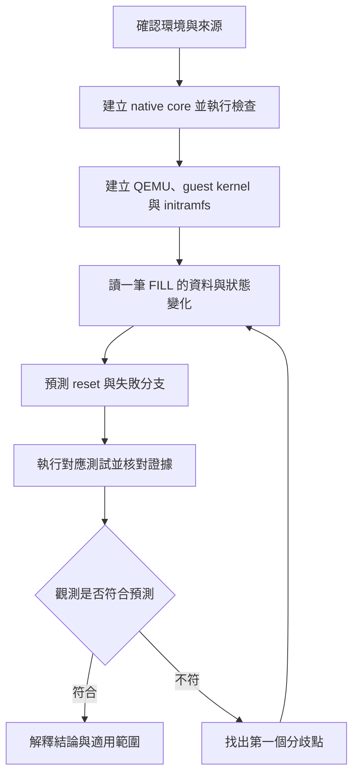

# 閱讀路線與實作練習

本教材以一筆 FILL 請求為主線：先建立可執行環境，再追蹤資料如何進入裝置、完成結果如何公開，
最後分析 reset 如何使舊工作失效。閱讀結果應能由命令、程式碼位置、狀態值和測試結果共同核對。

在 GitHub 直接開啟各章 Markdown，即可閱讀表格、程式片段與 Mermaid 圖。
`handbook.html` 是下載後使用瀏覽器開啟的離線合訂本；GitHub 的檔案頁面顯示 HTML 原始碼。
圖的語法與 GitHub 支援方式見 [GitHub 圖表文件](https://docs.github.com/en/get-started/writing-on-github/working-with-advanced-formatting/creating-diagrams)。

## 1. 前置知識與補讀位置

閱讀程式前，至少應能解釋 C 的指標、陣列、struct、bit mask、函式指標、回傳碼與資源生命週期。
操作環境需要基本 shell 命令、工作目錄、程序、檔案描述符，以及 Make target 的概念。
還不熟悉 PCI、VFIO、IOMMU 時，可先從下表建立最小概念，再進入實作。

| 概念 | 在此專案的精確意思 | 對應閱讀 |
|---|---|---|
| PF / VF | PCIe function；PF 提供管理入口，VF 提供可分配的資料入口。分出 VF 不等於已建立 DMA 隔離 | [系統分析](SYSTEM_ANALYSIS_ZH.md) |
| Driver | guest Linux 內的核心模組 `toy_pf.ko`；管理 PF、協調交易與 lease | [Kernel 導讀](KERNEL_WALKTHROUGH_ZH.md) |
| `fwcore` | portable C 裝置控制邏輯，管理 VF FSM、ledger 和 mailbox；QEMU 以 adapter 呼叫它 | [原始碼導讀](TRACE_CODE_ZH.md) |
| VFIO | guest 核心提供的裝置存取介面；tenant 以 fd、ioctl 管理 VF、DMA mapping 與 IRQ | [工具與技術](TOOLS_DEEP_DIVE_ZH.md) |
| IOVA | 裝置發出 DMA 時使用的位址；由 requester 對應的 IOMMU domain 轉譯，不能當成 CPU pointer | [位址與權限](TRACE_CODE_ZH.md) |
| SQ / CQ | SQ 存提交描述元，CQ 存完成紀錄；兩者有各自的 producer / consumer 進度 | [追蹤練習](TRACE_PRACTICE_ZH.md) |
| Fence | 阻止特定 VF 繼續 DMA 的裝置條件；須與 cancel、generation 和 readback 一起分析 | [系統指南](SYSTEM_GUIDE_ZH.md) |
| Epoch / session / token | 識別不同生命週期的工作；用途和更新時機不同，不能合併成一個模糊的「版本號」 | [重置追蹤](TRACE_CODE_ZH.md) |
| Artifact | 一次執行留下的命令、輸出與結果。公開包不附本機 raw logs，重跑後才會產生相應路徑 | [驗證紀錄](VALIDATION.md) |

這裡的「firmware」主要指 `fwcore` 所實作的控制邏輯，不表示正在刷寫實體裝置。
UEFI app 則在 guest Linux 啟動前執行，驗證開機階段的 probe 與 handoff；兩者的執行環境不同。

## 2. 按成果前進

不必一次讀完所有章節。每一站先做指定操作，再用完成條件決定是否往下走。

| 順序 | 章節與操作 | 完成條件 | 尚無法回答時回查 |
|---|---|---|---|
| 1 | [從零建置](BUILD_TUTORIAL_ZH.md)：確認 L0/L1/L2，安裝相依套件，取得 pinned sources | 能指出命令在哪一層執行、build 與 artifacts 在哪裡，以及來源如何固定 | `Makefile`、`sources.lock.json`、environment result |
| 2 | [工具與技術](TOOLS_DEEP_DIVE_ZH.md)：讀 compile/link、Kbuild、initramfs 與 TCG | 能區分 compiler error、linker error、模組載入失敗和 guest boot 失敗 | 該次執行的第一個錯誤與完整 argv |
| 3 | [系統分析](SYSTEM_ANALYSIS_ZH.md)：畫出 tenant、PF driver、QEMU、fwcore 的邊界 | 每個狀態、fd、mapping 和 queue 都有明確管理者 | 所有權矩陣與資料流圖 |
| 4 | [Kernel 導讀](KERNEL_WALKTHROUGH_ZH.md)：讀 probe、open/ioctl、IRQ/work、remove | 能把每次資源取得配到釋放分支，說明哪些操作能睡眠 | probe unwind 與 driver context |
| 5 | [逐函式追蹤](TRACE_CODE_ZH.md)：追正常 FILL、stale descriptor、DMA fault、reset | 能說出每個 guard 拒絕什麼，以及拒絕後哪些副作用不可發生 | 對應函式與關鍵程式片段 |
| 6 | [追蹤練習](TRACE_PRACTICE_ZH.md)：手算 ring，再執行 native GDB 練習 | 預測值能和程式核對，且能辨識同程序呼叫與跨層事件 | 逐步表與 GDB 變數 |
| 7 | [除錯方法](DEBUGGING_ZH.md)與 [BUG 紀錄](BUG_LOG.md)：選一個已記錄案例重建因果 | 能分別寫出症狀、假說、觀測、修正和回歸範圍 | 原始案例的 evidence 路徑與限制 |
| 8 | [DEMO](DEMO_ZH.md)與[驗證](VALIDATION.md)：執行適用的驗收入口 | 依結構化結果與 raw logs 說明結論，保留未執行與不支援項目 | [需求](REQUIREMENTS.md)與 aggregate result |

圖中的循環是閱讀與驗證流程，不是 `make verify-project` 的內部呼叫圖。
實際建置相依順序由 [建置章節](BUILD_TUTORIAL_ZH.md)與 `tools/verify_project.py` 定義。

## 3. 每一段程式都回答同一組問題

讀碼時先選定一個具體輸入，例如 VF 0 的 FILL，或 `RECOVERING` 狀態下的舊 callback。
每走過一個函式，就填入下面的表；沒有證據的欄位保留為「待確認」。

| 欄位 | 要寫的內容 |
|---|---|
| 入口 | 誰觸發？一般 call、timer、MMIO、IRQ 或 ioctl？在哪個程序與 context 執行？ |
| 輸入 | VF、request id、IOVA、length、epoch；位元組順序與值域是否已檢查？ |
| Guard | 拒絕的條件與回傳碼；檢查失敗之前是否已改變狀態？ |
| 狀態 | 哪些欄位讀取或更新？更新者是 core、driver、device 還是 owner？ |
| 副作用 | 是否配置資源、DMA、發布 CQ、送 IRQ、扣 quota 或釋放 mapping？ |
| 返回與失敗 | 呼叫者如何處理回傳碼？已取得的資源由誰回收？ |
| 證據 | 原始碼位置、測試輸入、result 欄位或同一次執行的 log |

例如「DMA 已失敗」仍不足以判斷整筆操作。必須再區分 SQ fetch、payload read/write、
CQ body 與 CQ phase 哪一次失敗；它們的狀態、可見性和回報途徑不同。
具體分支見 [程式追蹤](TRACE_CODE_ZH.md)與[除錯方法](DEBUGGING_ZH.md)。

## 4. 先預測，再核對

先遮住答案，寫下推論及程式依據；核對後修正錯誤的那個環節。
第一次可以沿完整範例逐項填表；第二次只看入口與輸入，自己補齊中間狀態；
隔一段時間，再換一個失敗條件重做。這種要求自行回想並提供核對機會的練習，
參考 [CMU 的 retrieval practice 說明](https://www.cmu.edu/teaching/resources/instructionalstrategies/activelearningstrategies/retrievalpractice/)。

### 問：VF 狀態是 ACTIVE，是否足以讓它 DMA？

答：不足。還要檢查有效 configuration、BME、fence、kill 和工作世代等條件。
先在 `device/toy_hw.c` 找 `gate()`，再查 `dma()`、`toy_irq()` 與 `toy_complete()` 的檢查位置。
狀態表描述合法生命週期，資料 gate 決定此刻能不能做副作用。

### 問：舊 descriptor 的 epoch 不符，SQ_HEAD 前進後 CQ_TAIL 一定也前進嗎？

答：不一定。此專案消耗 stale descriptor 並增加計數，卻不對舊工作 DMA payload 或 CQ。
所以 SQ 與 CQ 的 index 可以不同，計算 slot 時須各用自己的 counter。
到 [ring 練習](TRACE_PRACTICE_ZH.md)手算一次，再找裝置分支與 owner 消費邏輯核對。

### 問：看見 eventfd 可讀，能否立即認定某個 request 成功？

答：不能。eventfd 是通知，owner 仍須檢查 CQ phase、request id、epoch、status，
以及該操作預期的資料內容。通知次數與完成紀錄數量不是同一個計數。

### 問：UNMAP 成功、fd 都關閉，是否足以證明 VF 已可重用？

答：還要核對裝置狀態、outstanding work、PCI presence、quota、lease 與隔離條件。
CPU 端資源回收不能單獨證明裝置端已安全收斂；B001 的時間累積案例正好說明這個差異。

### 問：單元測試通過，能否略過 VM 驗收？

答：不能。fake HAL 可精確檢查 core 的輸入輸出與不變條件，卻未執行 guest PCI、
VFIO TYPE1、IOMMU 和中斷的真實整合路徑。每一層測試能支持的結論見 [系統分析](SYSTEM_ANALYSIS_ZH.md)。

## 5. 讀完一個 BUG 的核對題

選 [BUG_LOG](BUG_LOG.md)中的一個案例，先自行回答：

1. 最早的異常是 compiler error、程序錯誤、裝置狀態、DMA fault，還是 validator 判斷？
2. 哪項觀測能區分兩個可能原因？缺少哪一項證據就不能下結論？
3. 修正改變的是產品行為、測試前置條件、觀測時點，還是判讀規則？
4. 哪個條件必須維持，才能避免「讓測試變綠」卻削弱隔離？
5. 需要重跑哪個最小案例，以及哪一組受影響整合測試？

答案應能連到程式與證據，而非只重述「已修正」。歷史 log 路徑用於辨識當時執行；
公開 checkout 沒有這些本機檔案時，不把缺檔當成新的故障，也不宣稱已自行重現。

## 6. 操作、解釋與查表

實作時沿[建置](BUILD_TUTORIAL_ZH.md)、[追蹤練習](TRACE_PRACTICE_ZH.md)和[除錯](DEBUGGING_ZH.md)前進；
遇到「為什麼」回到[系統分析](SYSTEM_ANALYSIS_ZH.md)與[系統指南](SYSTEM_GUIDE_ZH.md)；
需要精確欄位和約束時查 [REGMAP](REGMAP.md)、[MEMORY_ORDER](MEMORY_ORDER.md)、
[M3 contract](M3_CONTRACT.md)及[需求](REQUIREMENTS.md)。
這個安排參考 [Diátaxis 對操作教學、解釋與參考文件的區分](https://diataxis.fr/start-here/)。
