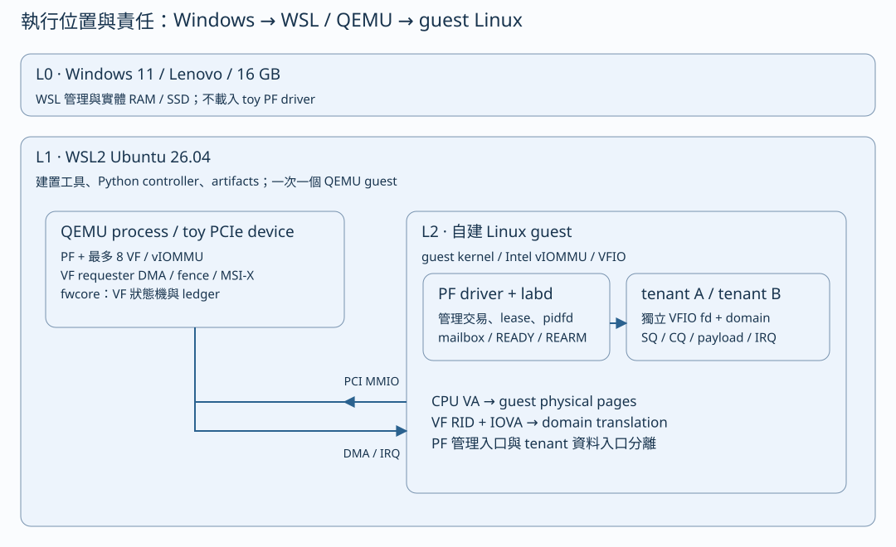
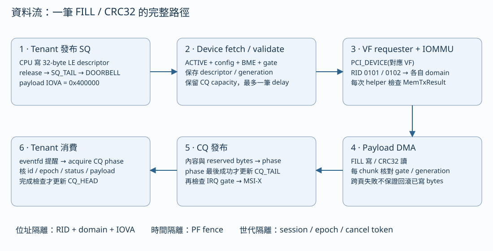
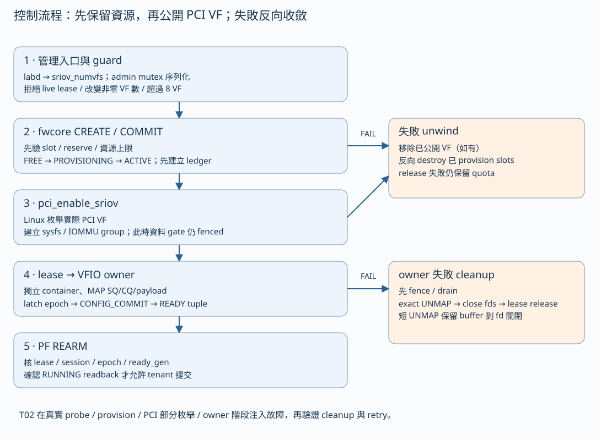
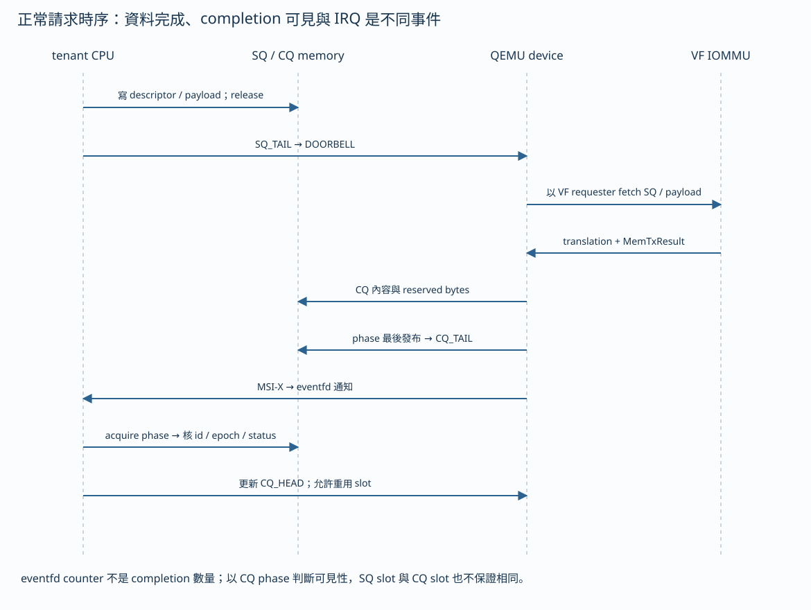
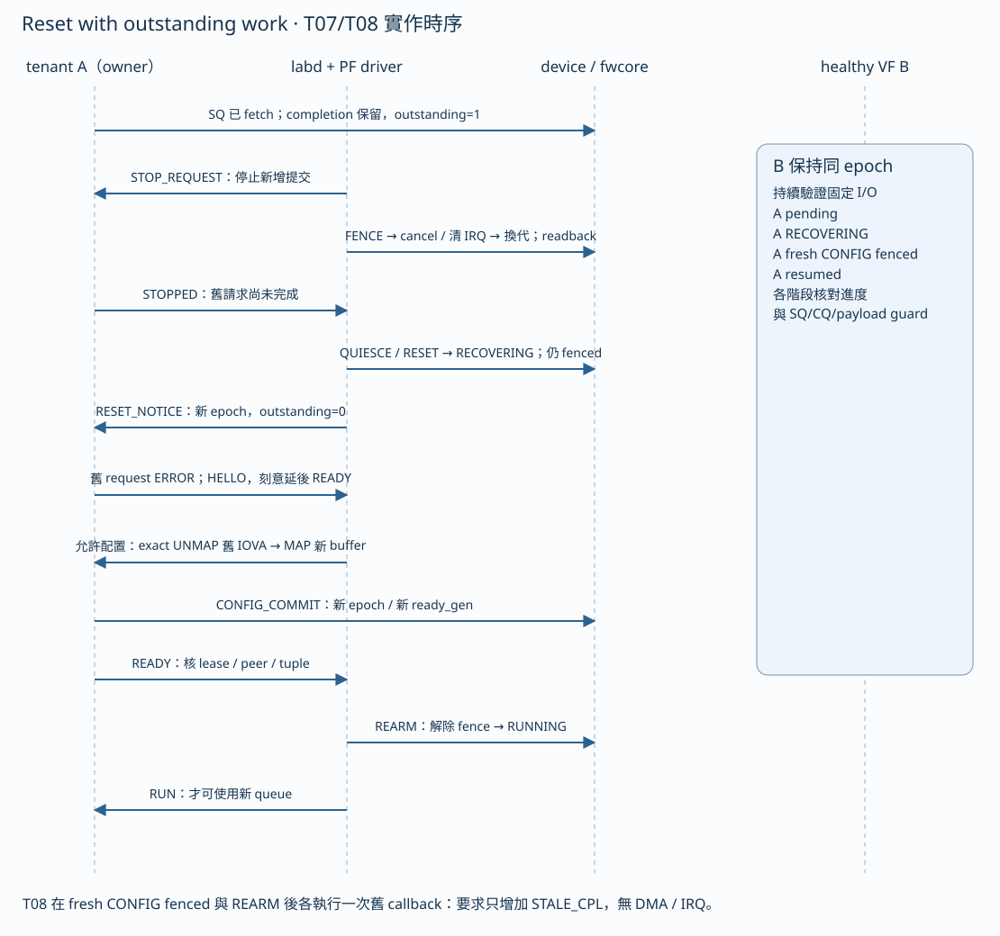
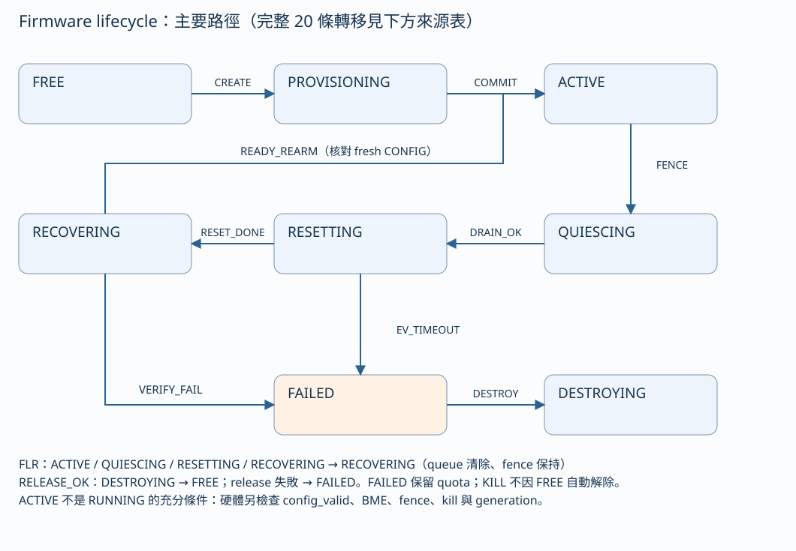
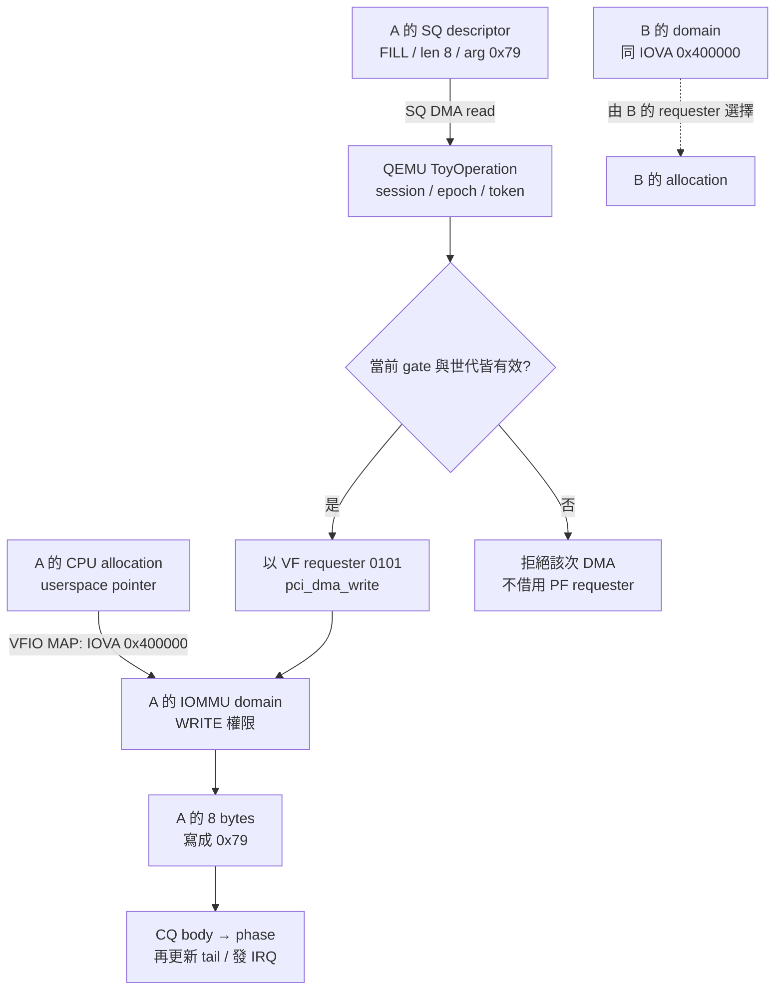
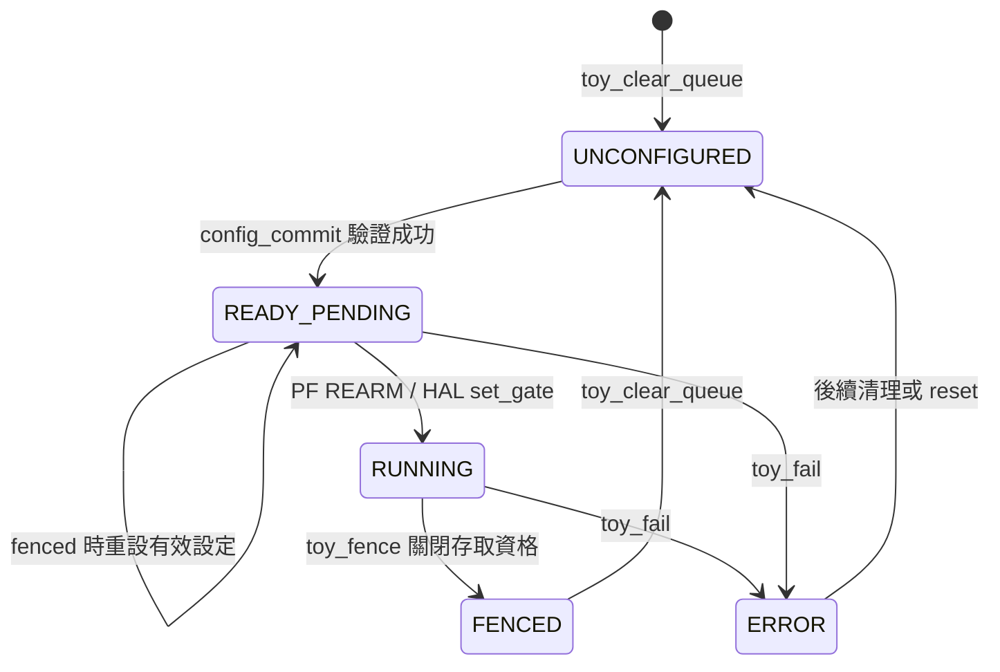
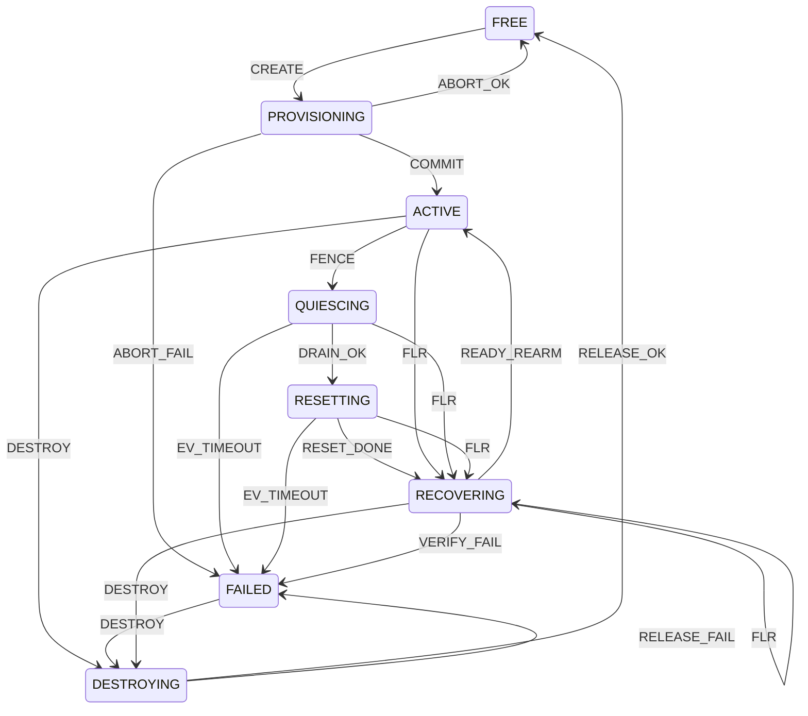
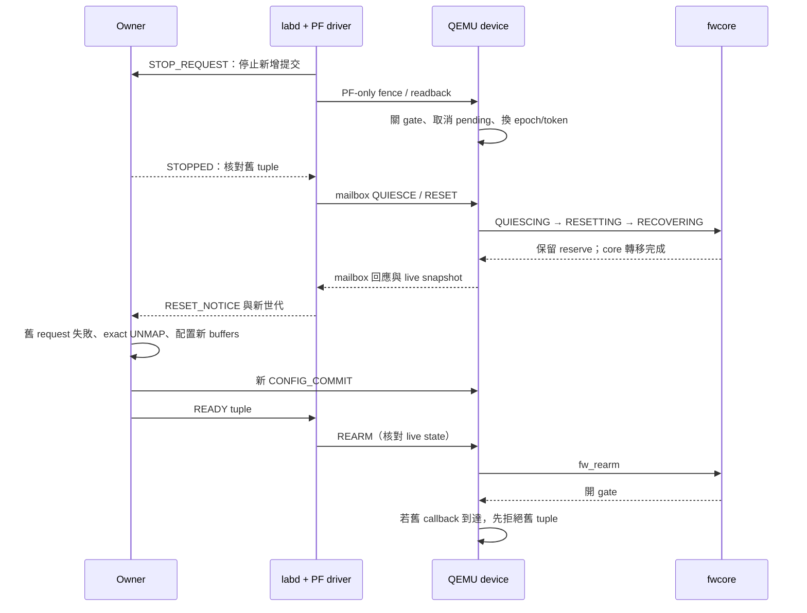

# 系統分析與圖解

本章描述本版 M0–M3 的責任分工與設計契約。每張圖都要搭配 guard 與測試證據閱讀，不能把示意圖當成無條件保證。
離線教材由 `tools/build_handbook.py` 產生，SVG 不需要網路、JavaScript 或外部字型。

## 架構與所有權

先用一個情境理解需求：兩個程式各自使用一個 VF，都把 payload IOVA 設成 `0x400000`。
A reset 時，B 必須繼續工作；A 的舊 callback 不能寫進重新配置後的新 buffer。
因此系統同時需要「位址歸誰」「何時能存取」「工作是否過期」三種判斷。

| 需求 | 可檢查的不變條件 | 主要證據 |
|---|---|---|
| A 不能寫到 B | 每次 DMA 用 A 的 VF requester／domain；B 的整個 buffer 不變或只發生自己的預期變化 | T04 同 IOVA、T05 fault 與 healthy VF |
| reset 不留下舊工作 | fence 生效後 epoch/token 改變，callback 執行前的世代檢查拒絕舊 tuple | T07/T08、retired/new buffers、eventfd |
| owner 失敗不能漏資源 | mapping、fd、child、lease、PCI function、ledger 各自回收；失敗時保留 quarantine | T01 100 輪、T02 unwind |
| queue 可重用 | u32 差值有界、phase 區分世代、CQ_HEAD 在讀完後更新 | T03、native ring oracle |
| 管理重送不重複扣 quota | session/sequence 加完整 request 比較、cached reply | M0 mailbox oracle/unit |

## 六張圖的閱讀順序

架構圖回答「在哪裡執行」，資料流回答「資料去哪裡」，控制流回答「誰決定下一步」，
正常 I/O 與 reset 時序回答「何時發生」，FSM 回答「這個事件現在是否合法」。
閱讀時可先選一條正常路徑，再指出一個失敗分支，避免一次展示所有細節。

QEMU process 在 WSL 執行；guest 的 PCI config/MMIO 操作會進入 QEMU 的裝置 callback。
圖中的「firmware」是連進 QEMU process 的 portable core。L2 driver 在 guest CPU 上執行，
不能直接呼叫 host QEMU process 裡的 fwcore 函式，必須透過 register/mailbox 介面控制裝置。

| 元件 | 負責內容 | 不應擅自代做的事 |
|---|---|---|
| `fwcore` | authoritative FSM、quota/queue/vector ledger、mailbox protocol、logical scheduler | 不配置 Linux fd，不直接呼叫 VFIO |
| QEMU toy device | PCI presentation、registers、模擬硬體 gate、VF requester DMA、virtual clock | 不因 Linux 枚舉了 VF 就私自修改 ledger |
| PF driver | host 管理交易、mailbox adapter、lease、event、driver lifetime | 不由 PF 替 tenant UNMAP，不另建矛盾 FSM |
| labd | owner 啟停、SO_PEERCRED/pidfd、tuple 驗證、reset handshake | 不把文字 READY 當作硬體已 RUNNING |
| tenant | 自身 VFIO container/group/device、eventfd、SQ/CQ/payload allocation/mapping | 不操作 PF BAR 或另一 tenant 的 fd |
| L1 test controller | 啟動一台 VM、ACK fault、保存原始輸出、獨立檢查 | 不直接改 guest buffer 偽造裝置結果 |

## 資料流：隔離在每次 DMA 都必須成立

相同 IOVA 並不表示同一塊記憶體。IOMMU translation 還取決於 requester 及其 domain。
SQ 是裝置讀，CQ 是裝置寫，payload 依 opcode 決定方向。每次 helper 的錯誤回傳都要處理；
成功 fetch descriptor 不保證稍後的 payload 或 CQ 也能存取。

CQ phase 是最後發布的 byte。Tenant 先檢查 phase/acquire，再讀 CQ 其他欄位及 payload，
最後更新 CQ_HEAD。IRQ 只通知「可能有新進度」，不代替 CQ 的有效性檢查。

## 控制時序：正常配置

1. labd 透過 PF driver PROVISION，再由 Linux enable SR-IOV。
2. PF lease 成立後啟動 owner；VFIO open 可能引發 FLR，owner 重新讀 session/epoch。
3. owner MAP 自己的 buffers、建立 MSI-X eventfd、寫 staging registers 與 CONFIG_COMMIT。
4. owner 發 READY，labd 核對 peer、lease、operation、session/epoch/ready_gen。
5. PF REARM 核對 live hardware state，確認 RUNNING，再讓 owner 開始提交。

若步驟 3 失敗，不能直接把 lease 當成沒發生；仍要確認 fence、mapping、fd 和 child 的清理。
若步驟 5 拒絕，owner 保持停止，不能重送 descriptor 試運氣。

## 正常 I/O 的時間與可見性

圖中的 fetch 是 SQ 與 CRC payload 的讀取路徑；FILL 的 payload 操作是以相同 VF requester 寫入，
兩種 opcode 都經 IOMMU 並檢查每次 DMA 回傳值。
Doorbell 表示「SQ 有新工作」，不表示工作已完成。DMA payload 成功，也不表示 CQ phase 已發布。
IRQ 發生後，tenant 仍以 phase/acquire 讀取 completion；eventfd counter 不能拿來當 CQ entry 數。
本版限定 x86_64 QEMU/VFIO MMIO 路徑；換到 non-coherent 實體平台時，cache maintenance 與 DMA barriers
需要平台專屬實作和重新驗證，不能只複製 C11 fence。
即使 coherent DMA memory 也仍需要正確 ordering；參見
[Linux 6.12 DMA mapping guide](https://docs.kernel.org/6.12/core-api/dma-api-howto.html)。
該文件說明 kernel DMA API；本專案 userspace VFIO 的具體存取順序仍應追 `owner_workload()`。

## 控制時序：有未完成請求的 reset

T07/T08 已驗證圖中的 retained work 與 stale callback，並通過完整 M3 回歸。
T06 另驗證 VFIO_DEVICE_RESET、queue readback、重新配置以及 healthy VF。
兩組測試觸發 reset 的路徑不同，不能互相替代。

Reset 時的兩個重點是「確認安全的順序」和「誰仍擁有記憶體」。PF 先關 gate/readback，
core 完成 quiesce/reset 到 RECOVERING；owner 將舊 request 標失敗，完成 exact UNMAP 後，
才建立新 queue。T08 刻意把已 UNMAP 的舊 CPU allocation 保留下來做 guard，
新 allocation 使用相同 IOVA，用來觀察 callback 是否錯碰新舊 memory。

不能只看 callback counter。必須實際執行帶有舊 session/epoch/token 的 callback，
檢查 STALE_CPL 而非 STALE_DESC，並確認 payload/CQ 未改及 eventfd 沒有新通知。

## FSM 與 queue gate 是兩張不同的圖

完整轉移表以 [`fwcore/fsm.c:edges`](../fwcore/fsm.c#L5) 的 20 條為準；離線 HTML 會直接從當前來源抽取表格。
圖只展示主要路徑與失敗匯流，不能拿示意箭頭當作所有合法 state/event 的枚舉。

從 FREE 到 ACTIVE 的 PROVISION commit，表示 firmware 已分配資源。它仍要求 hardware fenced，
且沒有 live config。這時的 ACTIVE 不代表 tenant 可 DMA。真正的執行條件位於
[`device/toy_hw.c:gate()`](../device/toy_hw.c#L161)：要求 ACTIVE、valid config、BME、沒有 fence/kill，並有正確 generation。

QUIESCING 與 RESETTING 的 logical deadline 各 100 ticks，RECOVERING 等 READY 為 1000 ticks。
裝置一 tick 是一毫秒 QEMU virtual time。PF driver 的 mailbox 上限為 5 秒，以 guest jiffies 計時；
labd／tenant 的 wire 上限為 120 秒，以 guest CLOCK_MONOTONIC 計時。它們不延長 core deadline，
也不是 WSL controller 的程序 timeout。因此可能出現「guest 管理程式仍在等待，裝置已 KILL」的狀態。

期限的精確邊界另以 native fake HAL 控制 logical clock，從正常 CREATE/COMMIT/REARM/FENCE
路徑進入 QUIESCING、RESETTING、RECOVERING，沒有直接改寫待測 deadline。
`artifacts/recovery-deadlines/20261013T074437Z-7f_3jtp_/` 保存九個實際讀值及 ASan/UBSan 執行：
quiesce/reset 在 99 不失敗，100/101 進 FAILED 且 KILL；READY 相應為 999/1000/1001。
這三種 timeout 情境都保留 8 credits。VM 的慢 READY 測試負責真實跨層握手；native 測試負責精確邊界，
不宣稱 QMP polling 可以準確停在每一個 VM tick。

FAILED 會保留 reserve；已驗證 owners closed、PCI/config/outstanding 清除後，DESTROY 可以釋放 ledger，
但 KILL 仍需 global recovery 才能清除。故 FREE、FENCED 和 KILLED 可同時出現，
並不是只看 FREE 就能接受為乾淨測試基線。

## 測試結果能支持哪些結論

| 證據層 | 檢查內容 | 不能替代 |
|---|---|---|
| Native core unit/oracle/fuzz | 轉移、ledger、bounded parser、scheduler 算法 | 真實 PCI/VFIO、driver lifetime |
| Guest KASAN + VFIO | kernel memory safety 診斷、實際 map/reset/owner 路徑 | 未觸發路徑、KCSAN race、硬體效能 |
| QEMU requester/gate trace | 該次 DMA/RID、fence、generation、callback 路徑 | 整個 buffer 是否正確、host process leak |
| Whole-buffer + exact UNMAP + pidfd | 資料變化及 ownership cleanup | 所有無限可能時序都沒有 BUG |
| 保存 raw logs 並重新解析 | PASS 可追溯到真正執行與預期語意 | 沒執行的 case、原始碼存在本身 |

應說明結論來自哪一層測試，以及該測試尚未涵蓋的情境。

## 錯誤分類決定恢復動作

| 錯誤類型 | 即時動作 | 為何不能一律 retry |
|---|---|---|
| 格式錯誤 descriptor | BAD_DESC completion，核對無額外 payload 改動 | 同一筆錯誤輸入重送不會變正確 |
| old epoch descriptor | consume SQ、增加 STALE_DESC、不產生 CQ | 若回寫舊 CQ，可能碰到新 owner 的資料 |
| DMA fault | 能安全寫 CQ 時回 `FW_DMA`（wire status 5），再 fence/fail | mapping 可能已失效，重試可能破壞隔離 |
| old callback | 增加 STALE_CPL、禁止 payload/CQ/IRQ | 即使新 queue 已 RUNNING，舊工作仍無權存取 |
| cleanup 不完整 | 保留 quota 或 buffer 到已確認安全的階段 | 歸零計數會掩蓋實際 ownership |
| logical timeout | KILL／FAILED；保留資源待明確 recovery | guest 管理程式仍在等待，不代表可以延長裝置 deadline |

測試範圍為 M0–M3／T01–T10，不包含 hostile remove／crash 全矩陣或量產可靠度驗證。

## 從一筆 FILL 建立跨層資料模型

假設 owner A 的 VF 是 requester `0101`，它將 8-byte payload 映射到 IOVA `0x400000`，
並提交 FILL，`arg=0x79`。下圖的數字是解說用輸入；不是新增的執行紀錄。
要追蹤的物件有四個：CPU allocation、VFIO mapping、SQ descriptor，以及裝置保留的 operation。
它們的生命週期不同；取消 operation 不會替 owner 解除 mapping，UNMAP 也不會替裝置刪除 operation。

實際位址翻譯由 requester 所在的 IOMMU domain 決定。圖中 A 的 CPU pointer 只用於 VFIO MAP；
裝置取得的是 IOVA，不能把 pointer 直接塞進 descriptor。PF 本身也不是 A 的替代 DMA 身分。
可由 [`dma()`](../device/toy_hw.c) 中的 `PCI_DEVICE(s->vf)`，確認 SQ、payload、CQ 都使用同一個 VF。

| 物件／欄位 | 寫入者 | 讀取者 | 何時可以重用 |
|---|---|---|---|
| SQ entry bytes | tenant | QEMU 經 VF DMA | 已被裝置消費，且 workload 確認對應請求生命週期結束 |
| SQ tail | tenant | QEMU register callback／worker | 每次依完整 u32 counter 推進；不能只保存 masked slot |
| SQ head | QEMU | tenant 讀 register | fetch 後前進；stale descriptor 也可能只推進它 |
| CQ body／phase | QEMU 經 VF DMA | tenant | tenant 完成 phase/acquire 與內容核對，交還 CQ_HEAD 之後 |
| CQ head | tenant | QEMU | 只可交還已完成且已讀取的 entries |
| payload bytes | FILL 時裝置寫；CRC32 時裝置讀 | 依 opcode 決定 | 必須根據該 request 完成、取消及 fence 的結果判斷 |
| `pending`／`retired` operation | QEMU | worker／stale callback 測試 | 由裝置取消、消耗；不是 fd close 的直接副作用 |
| mapping 與 allocation | owner | VFIO／IOMMU／CPU | 安全停止工作後 exact UNMAP；失敗時採保留策略 |

這裡描述的是協定所有權。即使兩個元件在同一個 QEMU process 裡，也不能跳過 MMIO 和 DMA
的公開行為，直接修改 tenant 的記憶體來製造成功結果。

## 三個狀態維度的交集

判斷 VF 能不能工作，至少要同時回答三個問題：core 是否准入、硬體是否允許、owner 是否完成配置。
[`fw_rearm()`](../fwcore/admission.c) 會核對硬體快照；
[`config_commit()`](../device/toy_vf.c) 只提交 queue 設定；
[`gate()`](../device/toy_hw.c) 在實際 DMA／IRQ 前再次判斷。

| 階段 | Core state | Queue／硬體狀態 | Owner 狀態 | 可提交有效工作？ |
|---|---|---|---|---|
| 尚未配置 | FREE | FENCED、無 config | 無有效 lease | 否 |
| PROVISION commit 後 | ACTIVE | FENCED、無 config | 可能尚未開 VFIO | 否 |
| CONFIG_COMMIT 後 | ACTIVE 或 RECOVERING | READY_PENDING、config_valid、仍 FENCED | 已 MAP，尚待 PF 核對 READY | 否 |
| REARM 成功後 | ACTIVE | RUNNING、BME、無 fence／kill | READY tuple 與 live state 相符 | 是，仍受每次 gate 檢查 |
| reset 之後 | RECOVERING | FENCED、舊 config 已清除 | 舊 request 失敗，準備新 buffers | 否 |
| 不可安全恢復 | FAILED | KILLED、FENCED | cleanup 可能尚未完成 | 否；reserve 保留 |

以下是 queue configuration 的主要控制路徑。它不是 core FSM 的替代圖，也不枚舉所有非法 MMIO；
例如無效 CONFIG_COMMIT 可以只設定 `queue_error`，不一定改成 ERROR。

圖中的 FENCED 是存取資格的解說節點，不是 `queue_status` enum 值。
`toy_fence()` 並不直接把 `queue_status` 改成 FENCED；讀取狀態時要合併 flags 與 queue status。
這正是不能以一個 status 欄位代表整個系統的原因。

## Core FSM：事件與 guard 必須一起成立

下圖列出 [`fwcore/fsm.c`](../fwcore/fsm.c) 的 20 條 state/event 邊；
READY_REARM 實際經 `fw_vf_event()` 分派到 `fw_rearm()`，不能只找到箭頭就推論一定轉移。

| 事件 | 必查 guard／副作用 | 若省略會失去什麼 |
|---|---|---|
| CREATE | FREE、非零 reserve、未超總額；fenced、無 PCI/config/outstanding、未 killed | 可能覆用仍有硬體工作的 slot |
| COMMIT | 已 reserve、未 killed、無 config/outstanding；維持 fenced | 會把「已准入」與「可以 DMA」混在一起 |
| FENCE | 硬體已 fenced、硬體 epoch 大於 core epoch；HAL cancel 成功 | 舊工作可能仍被當成現在的工作 |
| DRAIN_OK | fenced 且 outstanding 為零 | RESETTING 會接收到尚未排除的工作 |
| RESET_DONE | outstanding 為零；HAL clear_queue 成功 | 新 owner 可能繼承舊 queue 設定 |
| READY_REARM | epoch／ready_gen 一致、config_valid、ready_pending、BME、未 killed、無 outstanding；未超期限 | 過期 READY 或舊設定可能重新開 gate |
| DESTROY | owners_closed、無 outstanding，並符合世代條件；clear_queue 成功 | ledger 可能提前回到可分配狀態 |
| RELEASE_OK | 無 PCI/config/outstanding、owners_closed、ledger 可扣回 | quota 歸零可能掩蓋尚未釋放的資源 |

一般 `fw_transition()` 會先確認合法邊，再讀取 HAL snapshot，並要求 fenced。
HAL 操作成功後才提交 `state`、`epoch`、`deadline`。這提供保守的失敗語意：
失敗回傳不能被上層解讀成「狀態已前進、資源已釋放」。CREATE 和 REARM 另有專用函式，
其 guard 必須分別追入，不能只讀 `switch(event)`。

## Reset 的資料保護證明如何拆解

設定舊 operation 的 tuple 為 `(session=1, epoch=7, token=9)`；fence 後 live tuple 可變為
`(1, 8, 10)`。數值僅用來示意。安全條件不是「舊 callback 應該不會再來」，而是它即使來了也無權寫入。

1. `toy_fence()` 先設 `fenced=true`，再取消 pending、清除 IRQ pending，最後增加 epoch/token。
2. `cancel_pending()` 留下 `retired` 副本供測試；它不再由正常 pending 路徑完成。
3. `toy_complete()` 先查 `op->valid`，再比 tuple。世代不符時增加 STALE_CPL，將 valid 清除後返回。
4. 世代相符仍要通過 gate；payload DMA、CQ DMA、IRQ 各有實際執行點的檢查。
5. Owner 在停止提交、完成 reset 協調後才撤銷舊映射。T08 保留舊 CPU allocations 作 guard，
   另外配置新 allocations 並重用相同 IOVA。

因此測試要同時觀察「舊 callback 確實被呼叫」與「新舊 buffers／CQ／IRQ 都未被它更動」。
只讓 callback 不執行，不能檢驗拒絕過期 tuple 的程式；只看 STALE_CPL 增加，也不能檢驗所有副作用。

圖中的 mailbox 和 MMIO 是 guest／QEMU 邊界，不是 PF driver 直接呼叫 host 的 C 函式。
詳細函式路徑見 [逐函式追蹤](TRACE_CODE_ZH.md)，重現與反證方式見 [定位與修正](DEBUGGING_ZH.md)。

## 設計取捨及其代價

| 選擇 | 得到的性質 | 付出的代價／驗證要求 |
|---|---|---|
| 每個 owner 獨立 VFIO domain | 同 IOVA 可指向不同 owner 記憶體，隔離邊界明確 | 必須核對 group 成員、requester、map 權限和實際資料 |
| portable core 不持有 OS 資源 | Native fake HAL 與 QEMU adapter 可使用同一份轉移／ledger 實作 | HAL 回傳與硬體快照必須可信；native PASS 不能替代 VM |
| staging + CONFIG_COMMIT + PF REARM | 分次 MMIO 不會直接讓半份 queue 開始 DMA | READY、世代、BME、deadline 的交集更複雜 |
| CQ phase 最後發布 | consumer 能以一個有效性欄位判斷 entry 是否可讀 | body、phase、tail、IRQ 的順序都要測；phase 成功前不可通知完成 |
| 失敗保留 reserve | 不將可能仍被占用的資源重新配給別人 | 可用容量下降，需明確 global recovery |
| 一次一台 TCG guest | 在有限 RAM 下保持可重現執行，減少建置競爭 | 不能以該結果推算實體吞吐、延遲或並行上限 |

## 自問自答：用反例檢查模型

**若 A、B 的 IOVA 一樣，如何證明沒有共用 payload？** 先找不同 requester/domain 的建立證據，
再讓 A 執行可辨識的寫入，檢查 B 整個 buffer 和 B 自己的正常進度。只印出兩個 PID 或兩個 fd 不足以證明。

**ACTIVE、RUNNING、owner READY 三者為何不能任選一個？** ACTIVE 管資源准入；RUNNING 反映 queue 執行設定；
READY 是帶 tuple 的跨程序訊息。延遲訊息可能仍寫 READY，但 live epoch 已改變，所以 REARM 必須再核對硬體快照。

**若 mutex 已確保 reset 和 ioctl 不同時執行，舊 callback 還會有問題嗎？** 會。Mutex 保護 CPU 管理操作，
不會撤回裝置已複製的 descriptor；operation tuple 與 gate 才處理這個時間邊界。

**當 CQ 滿了，為何不先取 SQ 再等等？** `service_one()` 在 CQ capacity 不足時不 fetch SQ，
避免產生無處發布的完成結果。讀者應再檢查 `pending.valid` 的限制，不能只看 backlog 數量。

**若 reset 後 reserve 仍為 8，是否表示 leak？** 未必；RECOVERING 保留配額是契約。
應問它是否在成功 DESTROY／RELEASE 後歸零，且 PCI、config、outstanding、lease 和 owner 都已清除。
