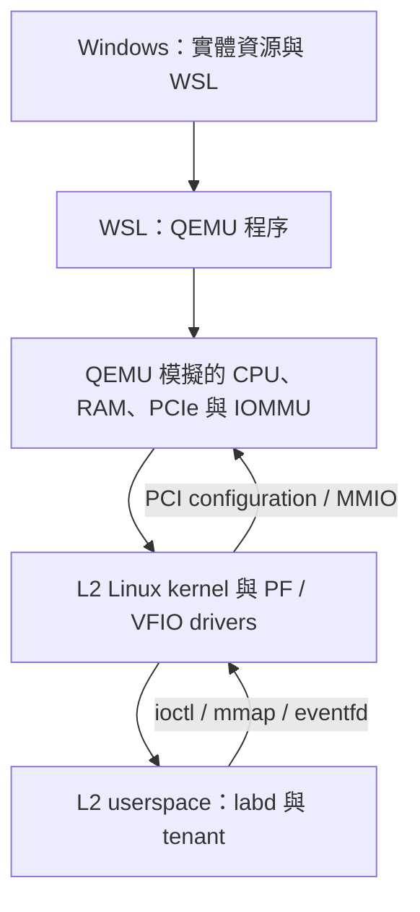
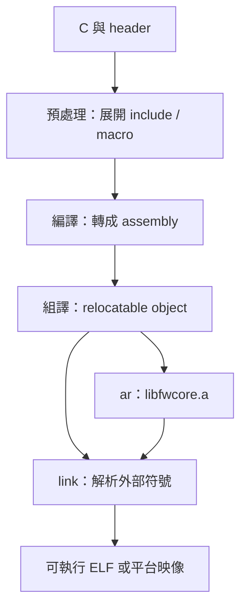
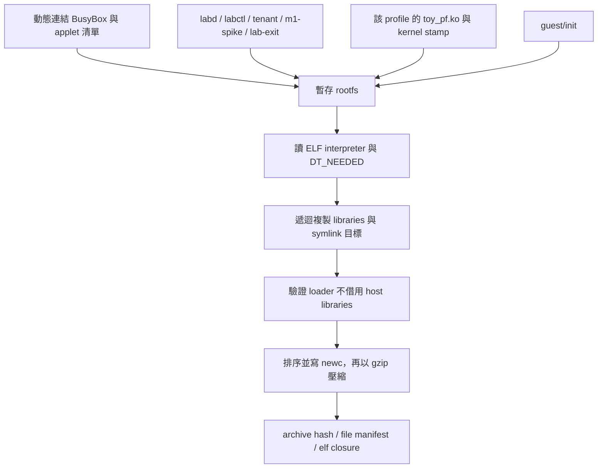
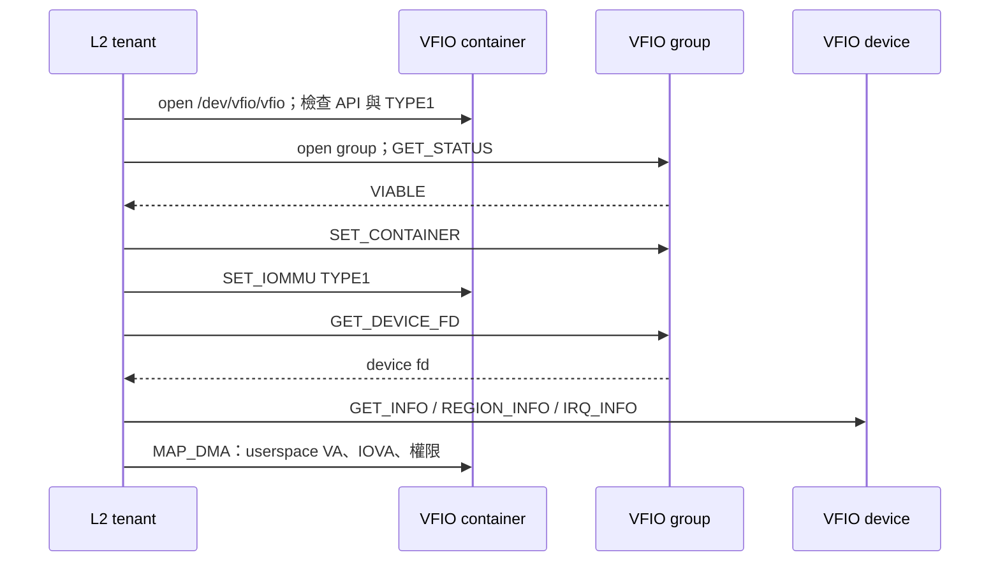

# 建置工具與執行環境

本章回答三個問題：每個工具把什麼輸入轉成什麼輸出、產物在哪一層執行，以及失敗時該檢查
哪個邊界。操作順序見 [從來源建置](BUILD_TUTORIAL_ZH.md)；本章的檢視命令均在 L1 WSL 的
repository 根目錄執行，並假設對應的建置步驟已完成。

先掌握 C 的函式、結構、指標、整數型別，以及 Linux 的程序、fd 和檔案路徑即可開始閱讀。
第一次出現的系統名詞會在其用途旁解釋。讀完後，應能指出 `.a`、`.ko`、ELF、`bzImage`、
initramfs 和 OVMF 之間的關係，並把同一個「找不到檔案」症狀拆成可驗證的不同原因。

## 1. 三層執行環境：同樣是 Linux，責任不同

| 層 | 實際執行者 | 可觀察的資源 | 本專案的用途 |
|---|---|---|---|
| L0 Windows | Windows 與 WSL 管理程式 | 實體 RAM、磁碟、WSL VHD | 提供外層資源，啟動 WSL |
| L1 WSL Linux | GCC、Python、QEMU 程序 | host fd、工作目錄、QEMU 記憶體與 Unix sockets | 建置、模擬與收集證據 |
| L2 QEMU guest | Linux kernel、`toy_pf.ko`、`labd`、tenant | guest PCI、VFIO fd、guest IOVA、SQ/CQ | 管理 VF 並執行資料工作 |

`toy_pf.ko` 由 L1 的 Kbuild 產生，卻由 L2 的 kernel 載入。`labd` 和 tenant 同樣在 L1 編譯，
再打包到 L2 執行。QEMU 的 `device/toy_hw.c` 在 L1 QEMU 程序內執行，向 L2 呈現 PCIe 裝置。
因此，單看編譯所在的機器，無法判斷程式的執行層。



圖中的向下箭頭表示提供執行環境；向上回到裝置模型的路徑表示實際 I/O。tenant 的普通 C
指標是 L2 userspace virtual address；傳給裝置的 IOVA 屬於該 VF 的 IOMMU domain，兩者不能互換。
裝置模型內另有 L1 QEMU 的 host pointer，讀 code 時必須保留這三種位址的區別。

**自問：在 WSL 對 `/dev/vfio/vfio` 做 ioctl，能直接觀察本專案的 VF 嗎？** 不能。
本專案的 toy VF 存在於 L2 模擬 PCI 拓樸，相關 VFIO ioctl 必須在 L2 執行。

## 2. Make 與 Python：排程入口和具體操作

頂層 [Makefile](../Makefile) 的 target 多半只呼叫一支 Python 工具；真正的來源準備、
compiler argv、hash 與錯誤處理位於 `tools/`。例如：

```make
build-kernel:
	$(PYTHON) $(ROOT)tools/build_kernel.py --profile $(PROFILE) --jobs $(JOBS)
```

讀這段時依序展開：`PROFILE=stress` 決定輸出與設定；`JOBS=2` 限制建置平行度；Python
工具選定 Linux source、GCC 14、Kbuild targets 與 log 路徑。`make -n build-kernel` 只會顯示
這個 Python 命令，無法顯示 Python 執行時才組合的所有子命令。實際 argv 應讀當次 artifacts。

[lab_common.run_logged()](../tools/lab_common.py) 把 argv、cwd、timeout、exit code 和執行秒數
寫入同名 JSON，把 stdout/stderr 合併到同名 `.log`。例如 kernel 的 `compile.json` 記錄
執行方式，`compile.log` 保存 compiler 輸出。當子程序失敗，工具先保存紀錄，再讓上層停止。
這讓 `make Error 2` 可以往下追到真正失敗的 GCC、Ninja 或 Kbuild 步驟。

頂層 `.NOTPARALLEL` 限制一輪 Make 的 target 排程；builder 仍可用 `-j 2` 編譯多個檔案。
QEMU、kernel、initramfs、EDK2 與 VM 共用
[resource_lock()](../tools/lab_common.py)，用非阻塞 `flock` 排除同時占用大型資源的另一輪工作。
Native core 沒有這把鎖；不要因為存在鎖就另外啟動一輪完整驗收。

**自問：等待中的 terminal 沒印進度，是否一定 deadlock？** 不一定。先辨認當前 stage，讀其
`.log`、檢查程序狀態與紀錄的 timeout。不要用啟動第二輪驗收測試第一輪是否還活著。

## 3. 從 C 到可執行檔：compile、archive、link

C 的一般產物路徑是預處理、編譯、組譯，再由 linker 解析符號和配置輸出。`gcc -c` 在產生
object file 後停止；沒有 `-c` 的建置命令可以繼續連結。這些階段與停止選項可對照
[GCC Overall Options](https://gcc.gnu.org/onlinedocs/gcc/Overall-Options.html)。



這是一般工具鏈關係。專案的
[build_core.build()](../tools/build_core.py) 先逐檔以 GCC `-O2 -c` 產生 `build/core/*.o`，
再用 `ar rcs` 集合成 `libfwcore.a`。這個 `.a` 是 object archive，沒有 `main()` 或可直接執行的
程序入口；建立 archive 也不要求所有跨檔案呼叫已解析。之後的 unit/oracle 測試會把全部 core
C sources、fake HAL 和測試入口一起編譯連結，並非執行 `.a`。

建置後，用 binutils 唯讀檢查產物：

```sh
ar t build/core/libfwcore.a
nm --defined-only build/core/fsm.o
nm --undefined-only build/core/fsm.o
readelf -h build/core/fsm.o
readelf -h build/core/native/unit
```

成功判斷：archive 可列出 core objects；`fsm.o` 是可重定位的 ELF；`unit` 是可執行程式。
啟用 PIE 的工具鏈可能把可執行檔標成 ELF `DYN`，不能只憑這個標籤判斷它一定是 library。
`nm` 列出的未定義符號表示該 object 尚須其他 objects 或 libraries 提供；若最終 link 仍無定義，
才會形成 `undefined reference`。

### 同一份 core 為什麼能進不同環境

[fw_port.h](../fwcore/fw_port.h) 在一般 C 環境使用 `<stdint.h>` 型別，在 `FW_UEFI` 下改用
UEFI 的固定寬度型別。[fw_hal.h](../fwcore/fw_hal.h) 則用函式指標把時間、讀硬體、關 gate、
取消 I/O 等動作交給 adapter。核心演算法因此不直接依賴 Linux syscall、QEMU object 或 UEFI
service；平台把對應 callback 填入 HAL。

Core builder 的 `-ffreestanding -fno-builtin` 宣告此程式不依賴一般 hosted C 環境的假設，並限制
對標準函式的 builtin 處理；它們不會自動替程式實作記憶體管理、中斷或硬體存取。Portable 的條件
仍包括型別、資料布局、生命週期及 HAL 契約。QEMU 和 EDK2 builder 會各自複製並編譯 core sources，
不會把 Linux userspace 測試 ELF 直接放進 firmware。

### 為何保留不同測試 binary

| 路徑 | 實際建置設定 | 回答的問題 | 無法單獨證明的事 |
|---|---|---|---|
| `build/core/native/` | GCC `-O2` | 原生 unit 與獨立 oracle 的行為是否相符 | guest driver、IOMMU 是否正確 |
| `build/core/sanitize/` | Clang ASan/UBSan、`-O1 -g` | 受測路徑是否出現可偵測的記憶體／未定義行為 | 所有輸入皆安全 |
| `build/core/coverage/` | GCC `--coverage`、`-O0 -g` | 測試曾經走到哪些來源路徑 | 每個已執行分支的語意皆正確 |
| `build/core/fuzz/` | libFuzzer、ASan/UBSan | 自動變異輸入能否打破受檢查條件 | 有限探索以外的輸入不會失敗 |

錯誤定位也跟著階段區分：`unknown type name` 先查 header／macro／C dialect；`undefined
reference` 查定義是否進 link inputs；執行期 sanitizer report 則從第一個 report 的 stack 和輸入追查。
最後一個 linker 或 Make 錯誤經常只是先前失敗的後果。

**自問：`.o` 有未定義符號是否就是壞檔？** 不是。跨檔案函式呼叫在 object 中留下待解析的
符號很正常；需檢查最終使用者是否提供定義。

## 4. Kbuild：設定、kernel 與外部 module 必須配套

[build_kernel.py](../tools/build_kernel.py) 先由
[kernel_source.prepare()](../tools/kernel_source.py) 建立 patched Linux 工作樹，再組合
`guest/configs/base.config` 與指定 profile 的 fragment。它呼叫 Kconfig 的 `allnoconfig`，以
`KCONFIG_ALLCONFIG` 傳入要求的設定，最後讀取**產生後的 `.config`** 檢查必要功能。

Fragment 表達要求，Kconfig 還要處理相依條件；把 `CONFIG_VFIO=y` 寫進 fragment，不等於最後
kernel 一定含有完整的 group/container/TYPE1 路徑。因此
[check_config.check()](../tools/check_config.py) 要求本專案必要功能為 built-in `y`，並禁止
本版本不使用的 VFIO NO-IOMMU、IOMMUFD、KCSAN 等設定。

```sh
python3 tools/check_config.py --profile stress
python3 tools/check_config.py --profile kasan
```

這兩條命令只檢查已存在的設定，不會編譯或開機。預期 JSON `status=PASS`；否則先處理
`missing_built_in` 或 `forbidden_enabled`，不要直接改掉檢查器。

### `-C`、`O=`、`M=` 各指向哪裡

| 參數 | 本專案位置 | 用途 |
|---|---|---|
| `make -C` | `build/linux-src` | 進入 Linux source，使用其 Kbuild 規則 |
| `O=` | `build/kernel-stress` 或 `build/kernel-kasan` | 保存 `.config`、generated headers、objects 與 kernel 產物 |
| `M=` | 對應輸出下的 `toy-pf/` | 告訴 Kbuild 建置外部 PF module |
| `CC=gcc-14` | pinned 工具鏈 | 編譯 guest kernel 與 PF module |
| `HOSTCC=gcc-14` | 同一建置命令 | 編譯 Kbuild 過程在 L1 執行的 host 工具 |

`CC` 與 `HOSTCC` 的工作不同；在本專案 x86_64 L1/L2 恰好可用同一工具鏈。外部 module 仍須使用
目標 kernel 的完整建置輸出，不能拿 WSL 當前 kernel 的 headers 代替。Kbuild 的 external module
介面見 [Linux 6.12 Building External Modules](https://docs.kernel.org/6.12/kbuild/modules.html)。

PF 的 [Kbuild](../guest/pf/Kbuild) 用 `obj-m += toy_pf.o` 指定 module，builder 把 driver sources
複製到 profile 的 `toy-pf/`，再產生 `.ko`。核心依賴 kernel symbols；`.ko` 不像普通 userspace
程式那樣經由 libc loader 啟動。

```sh
readelf -p .modinfo build/kernel-stress/toy-pf/toy_pf.ko
readelf -h build/kernel-stress/toy-pf/toy_pf.ko
```

`.modinfo` 中可觀察 module 的版本匹配資訊，例如 vermagic。它是排查 `invalid module format`
的一個線索，仍須同看 L2 `kernel.log` 的載入拒絕原因與 builder stamp。不要在 L1 `insmod` 來測試。

### stress 與 kasan 的差異

`stress` 用於一般功能與壓力驗證；`kasan` 額外啟用 KASAN、lockdep、debug list、kmemleak 等
觀測。兩個 profile 有各自的 `.config`、kernel、PF module 和 initramfs；runner 也給 kasan 較多
guest RAM。KASAN 檢查受測 kernel 的記憶體存取；它不會檢查 L1 QEMU C code 的所有錯誤。
Core 的 userspace ASan 與 L2 KASAN 的檢查範圍因此不同。

**自問：修改 PF driver 之後只重建 `.ko` 夠嗎？** 不夠。還需把新 module 封裝進對應
initramfs，確認配套 hashes，再重跑受影響的 guest gate。

## 5. Initramfs：檔案存在不代表程式能啟動

本專案把最小 userspace 放進 gzip 壓縮的 `newc` CPIO archive。Linux 開機解開映像後，依
kernel command line 的 `rdinit=/init` 啟動其中的 `/init`。Archive 不需要 partition table 或一般
磁碟 filesystem。Initramfs 的核心模型見
[Linux 6.12 ramfs/rootfs/initramfs](https://docs.kernel.org/6.12/filesystems/ramfs-rootfs-initramfs.html)。

[build_initramfs.build()](../tools/build_initramfs.py) 的資料依賴如下：



順序是先收集 binaries 與 module，補齊執行相依檔，再驗證與封裝。`runtime_validation=NOT_RUN`
表示此時只完成映像建置；必須啟動 VM 才能知道 `/init`、driver 與測試是否真正執行。

### ELF 的三種路徑依賴

動態連結 ELF 含有 interpreter 路徑，表示由哪個 loader 載入程式；`DT_NEEDED` 列出所需 shared
libraries，library 本身也可能再依賴其他 library；symlink 則可能把某個 SONAME 指向實際檔案。
三者都在 L1 存在，仍不代表映像內已完整。

```sh
readelf -W -l build/guest/tenant
readelf -W -d build/guest/tenant
gzip -dc build/initramfs-stress/initramfs.cpio.gz | cpio -it
```

第一條查 program interpreter；第二條查 `NEEDED` 與搜尋路徑；第三條只列 archive 內容，不解壓
到 host。預期看到 `/init` 對應 entry、BusyBox、guest programs、module、loader 和各相依檔。
CPIO entry 名稱可能沒有開頭 `/`；在 guest 解開後才是從 rootfs 根目錄解析的路徑。

`ElfClosure.metadata()` 使用 `readelf` 讀 metadata，拒絕不相符的 ELF architecture 與任何
`RPATH/RUNPATH`；`add()` 遞迴加入相依檔；`verify()` 使用 staged loader 的 `--list` 和指定
library paths 檢查解析結果，拒絕 library 路徑逃回 host。這個檢查不執行 tenant 的測試邏輯。
`elf-closure.json` 保存來源、hash 和解析關係，`file-manifest.json` 保存封裝路徑、mode 與內容
hash；遇到 shell 說 `not found`，先查這兩份證據，再判斷是否真的是 binary 不存在。

### 可重建的 archive 與可重現的全部系統

`write_archive()` 固定 archive entry 的順序、inode、uid/gid 與 mtime，gzip header 的 mtime
固定為 0，減少非內容因素造成的差異。它直接寫入 device node metadata，建置不需要 root。
這些措施只約束封裝；若 host shared libraries、compiler 或輸入 sources 改變，archive hash 仍會改變。
「相同 archive hash」與「重新驗證後行為相同」回答不同問題。

### `/init` 的第一個失敗如何定位

[guest/init](../guest/init) 先 mount proc/sysfs/devtmpfs 等，讀 `/proc/cmdline` 選擇 case，
再把測試協定切換到 UART1，檢查 PF、載入 module、建立控制節點，最後啟動 `m1-spike` 或 `labd`。

| 最後觀測到的位置 | 優先檢查 | 下一個有用的證據 |
|---|---|---|
| 尚無 `Linux version` | kernel／QEMU boot argv | `command.json`、`qemu.log`、`kernel.log` |
| kernel 啟動，無 `/init` 行為 | archive、script shebang、loader、執行權限 | file manifest、ELF closure、`kernel.log` |
| `GUEST_BOOT` FAIL | JSON 中的 `reason` 對應 init 檢查 | init 中 `fatal` 呼叫點及同輪 kernel log |
| `GUEST_BOOT` PASS，case 失敗 | 已進入測試程序 | `serial.log` 的第一筆錯誤與 `qemu.log` 裝置觀測 |

**自問：為什麼有 `/bin/sh` 還可能執行不了 script？** `/bin/sh` 可能是壞掉的 BusyBox symlink，
BusyBox 可能缺 loader/library，script 的 shebang 或換行也可能錯誤。應逐一驗證目標及相依路徑。

## 6. QEMU TCG、裝置模型與 QMP

TCG 把 guest CPU 指令轉成可由 host 執行的程式片段；system emulation 同時提供記憶體與裝置
模型。QMP 是控制與觀察 QEMU 的 JSON 協定，並非 guest userspace 的 VFIO 介面。
相關分工可對照 [QEMU system introduction](https://www.qemu.org/docs/master/system/introduction.html)。
本專案實際固定為 QEMU v9.2.0；命令是否可用仍以釘選 binary 的 help 與 builder 為準。

[build_qemu.py](../tools/build_qemu.py) 建立獨立 worktree、驗證整合 patch，把 `device/`、
`fwcore/` 和 `include/` 複製進 QEMU source tree。`configure --disable-download` 要求離線
依賴完整，再由 Ninja 建立 `qemu-system-x86_64`。缺 offline subproject 時要回到 fetch 階段，
不能讓 configure 臨時抓取另一份來源。

Runner 的重要設定如下；完整實際 argv 永遠以當次 `command.json` 為準：

| 設定 | 功能 | 缺少或不符時的影響 |
|---|---|---|
| `-machine q35` | 提供本專案使用的 x86 PCIe 平台 | 換 machine 會改變拓樸與 firmware 行為 |
| `-accel tcg,thread=multi`、兩個 vCPU | TCG 執行與排程條件 | 不應把 host CPU 效能推成真實硬體 DMA 效能 |
| `intel-iommu,intremap=on` | guest 可用的 vIOMMU 與中斷重映射 | VFIO TYPE1 domain 路徑不成立 |
| root port 與 `toy-sriov-pf` | toy PF/VF 的 PCIe 拓樸 | group、BDF、BAR 分配需要重新確認 |
| `-S` 加 QMP `cont` | 先連好觀測與測試通道，再開始執行 | 開機初期事件可能早於收集器 |
| UART0、UART1 | 分離 kernel 診斷與測試 JSON/ACK | printk 插入 JSON 可能破壞協定 |
| `-nic none` | 不提供測試不需要的 guest NIC | host 下載來源與 guest 執行仍是不同需求 |

PF/VF 裝置由 QEMU 模擬，但 L2 kernel 的 PCI、VFIO、TYPE1 MAP/UNMAP 和 eventfd 路徑是真正的
Linux 實作。T05 的 strict WRITE-only 行為另依賴專案釘選的 toy-only guest kernel patch，不能把
它延伸成 stock Linux 或實體卡的保證。

**自問：為什麼增加 timeout 可能讓 BUG 更難定位？** 如果原因是 checkpoint 未 ACK、queue
沒有 rearm 或舊 epoch 被拒絕，延長時間不會補上缺少的狀態轉移。先找最後成功事件及下一個
應出現的事件，再判斷是邏輯等待還是資源不足。

## 7. VFIO：fd、DMA mapping 與中斷的分工

本專案使用 Linux 6.12 的 classic VFIO group/container/TYPE1 介面。Group 是隔離與擁有權的
基本單位；container 可以容納 group 並設定 IOMMU。每個 VF 在本專案各自建立 container，
用來驗證獨立 domain；這是專案選擇。介面背景見
[Linux 6.12 VFIO](https://docs.kernel.org/6.12/driver-api/vfio.html)。

[lab_vfio_open()](../guest/tenant/vfio.c) 依序驗證 API 與 TYPE1 extension、開 group 並檢查
viable flag、把 group 加入 container、設定 IOMMU，最後取得 device fd 和 regions/IRQ
capabilities。任何一個 fd 只代表取得某一層的操作入口，不能省略後續檢查。



文字順序就是 container → group → attach → TYPE1 → device → capabilities → DMA mapping。
本版 owner 經 device fd 的 `pread`／`pwrite` 存取 BAR，不直接 mmap BAR，並解析 region
capabilities 來確認可用範圍；匿名 RAM 的 `mmap` 則用來配置 SQ/CQ/payload。
BAR 存取、DMA memory mapping 和 MSI-X 的 eventfd 設定各自完成不同工作：

| 操作 | 建立的關係 | 不會自動完成的事 |
|---|---|---|
| 查詢 region，以 `pread`／`pwrite` 存取 BAR | tenant 可以存取裝置 MMIO | 不會替 payload 建立 IOVA |
| `VFIO_IOMMU_MAP_DMA` | domain 中 IOVA 到已註冊 pages 與權限的映射 | 不會提交 SQ entry 或打開硬體 gate |
| MSI-X IRQ eventfd 設定 | interrupt vector 對應 userspace 可等待的通知 fd | 不表示 CQ 一定已有屬於當前 request 的成功結果 |
| 寫 doorbell | 告知裝置有新的 queue 進度 | 不代表 fetch、payload、CQ、IRQ 已全部成功 |

因此，收到 eventfd 後仍須檢查 CQ 的 phase、id、epoch、status、len 與預期結果；
session 屬於 owner 與裝置的世代管理資訊，不是 CQ wire 欄位。反過來，沒有 eventfd
也不能立即認定裝置沒做事：可能已有 CQ、IRQ 被遮罩，或通知設定本身出錯。完整追蹤見
[TRACE_CODE_ZH](TRACE_CODE_ZH.md) 與 [TRACE_PRACTICE_ZH](TRACE_PRACTICE_ZH.md)。

回收時，MAP/UNMAP 的 extent、buffer 的生命週期和 VFIO fd 必須一致。
[lab_vfio_close()](../guest/tenant/vfio.c) 檢查 UNMAP 回報的 size；若沒有完整解除 mapping，
不能先釋放仍可能被 pin 的 allocation。owner 的完整資料路徑另有其資源 ledger，閱讀時不要把
簡單 map probe 的回收流程直接套成所有 queue 的規則。

**自問：兩個 VF 使用相同 IOVA 是否一定衝突？** 不一定。位址解釋取決於 requester 所屬
domain；獨立 domain 可讓相同 IOVA 指向不同 pages。要證明隔離，還需觀測實際 VF requester
與各自 payload／CQ，不能只比較 userspace pointer 或 container fd 數值。

## 8. EDK2 與 Linux boot：另一條平台路徑

M1 可由 QEMU 直接載入 kernel/initramfs；M2 則先執行 OVMF 和 SriovProbe，再測同次開機
交給 Linux 的 handoff。兩條路徑共享裝置與 Linux 產物，卻檢查不同初始化責任。

[build_edk2.py](../tools/build_edk2.py) 的建置層次如下：

1. **BaseTools** 在 L1 執行，處理 EDK2 描述檔、編譯規則與 firmware 映像。
2. **SriovFwPkg** 產生 `SriovProbe.efi`，在 L2 UEFI 環境執行並使用可攜 core。
3. **OVMF variants** 產生 SR-IOV support PCD 開啟／關閉的 firmware，保留實際 build 產生的
   `PciBusDxe` AutoGen.h，核對 PCD 是否生效。
4. **CODE/VARS** 分別提供 firmware code 與 variable storage 的配套映像；runner 為每次開機
   準備新的 VARS 複本，避免前次 NVRAM 狀態污染結果。

EDK2 的 `GCC5` 是工具鏈規則名稱，本專案用 wrapper 指向已釘選的 GCC 14。看到 build tag
不能直接推斷執行的 compiler 主版本。`--prepare-only` 也只代表來源準備，工具會保留建置與
runtime 尚未執行的狀態；它不能作為 M2 PASS。

**自問：SriovProbe 回傳成功，是否就完成 handoff？** 尚未。還要在同輪 log 中找到
`HANDOFF_START`、Linux 開機、PF/VFIO 測試及 host validator 的完整結果。若只有 probe 輸出，
Linux 接手和後續 I/O 仍未被證明。細節見 [UEFI](UEFI.md)。

## 9. 閱讀失敗的固定順序

遇到失敗先做分類，再決定工具。這個順序避免把載入錯誤當成編譯錯誤，或把觀測通道損壞當成
裝置功能失敗。

| 問題 | 先確認 | 接著使用的工具或來源 |
|---|---|---|
| 來源是否正確 | commit、patch hash、是否 dirty | `sources.lock.json`、Git、fetch log |
| 產物是否產生 | 第一個失敗的子命令及 exit code | builder stage JSON／log |
| 產物是否配套 | kernel/module/initramfs hashes 與 profile | stamps、runner 的 build check |
| 程式是否可載入 | ELF architecture、interpreter、NEEDED、symlink | `readelf`、ELF closure、manifest |
| kernel 是否開機 | UART0 的 Linux banner 與第一個診斷 | `kernel.log`、`command.json` |
| 測試是否開始 | `GUEST_BOOT`、case、第一個 checkpoint | `serial.log`、`guest/init` |
| 裝置是否完成動作 | requester、queue counter、fence/epoch、DMA 結果 | `qemu.log`、QMP ACK、source trace |
| 完整結果是否可接受 | deadline、raw evidence、所有 case 與 validator | 當輪 `result.json` 及其引用檔案 |

先用上表說明「最後已知正確的位置」，再寫下一個必須成立的條件。例如：kernel 已啟動，
`insmod` 失敗 → 查 module 搭配與 kernel 拒絕原因；CQ 已前進，tenant timeout → 查當前 epoch、
CQ phase 與 IRQ 等待路徑。每次只修正有證據支持的原因，保留原始 FAIL，重跑後比較新的結果。

可用以下三題檢查是否掌握各層：

1. **`build-core` PASS，但 kernel build FAIL，哪份程式真的執行過？** L1 建置工具成功產生
   core 產物；只有 `verify-m0` 才執行 core 驗證。Kernel 尚未產生不代表 core 邏輯錯誤，需從
   kernel 首個 compiler/config 錯誤追查。
2. **`build-initramfs` PASS，但 VM 缺少 `GUEST_BOOT`，哪裡仍未被證明？** 封裝與 loader
   檢查已成立，L2 開機、mount、UART 切換、module probe 等 runtime 路徑仍可能失敗。
3. **Guest 印 PASS，但 host result FAIL，要以哪個為準？** 先查 host 拒絕原因。Guest 的局部
   成功訊息無法取代 raw evidence 完整性、unexpected kernel reports 與跨層契約檢查。
