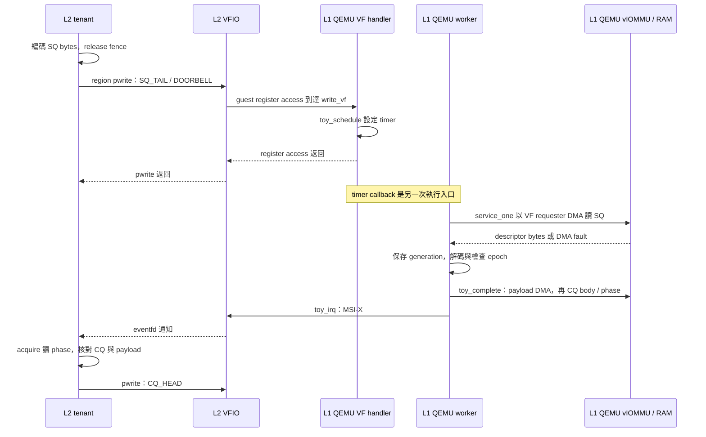
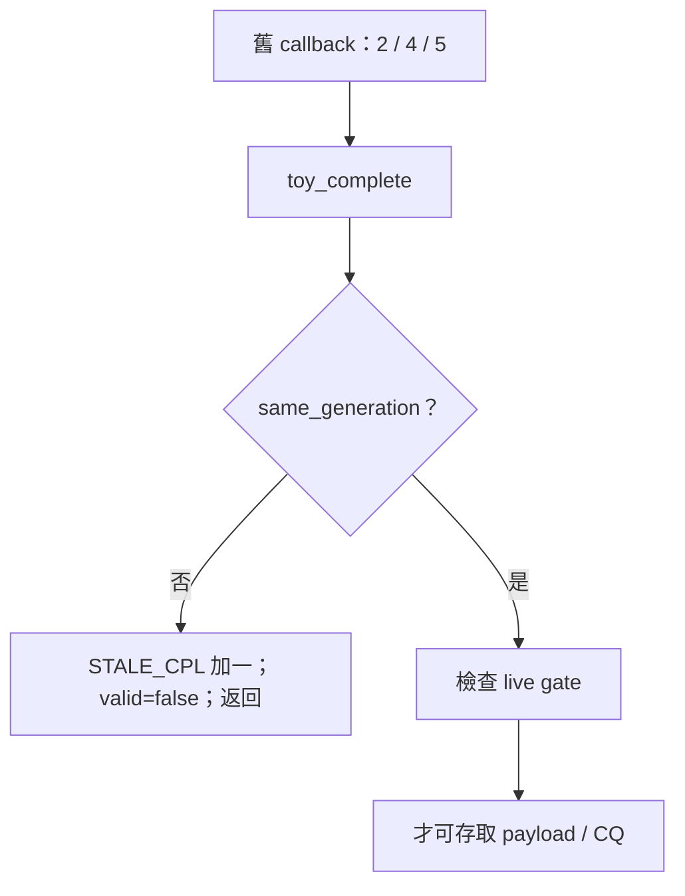

# 動手追蹤：一筆請求、兩個游標與一次重置

本章從一筆 FILL 請求開始，練習辨認資料放在哪裡、何時跨越邊界、由誰更新狀態。
先讀範例，再遮住答案追一次 CRC32 或 stale descriptor。圖中的箭頭分成兩種：

- `→`：同一執行環境內，圖中明示的呼叫或資料流；圖只列出與問題相關的步驟。
- `==>`：透過 MMIO、DMA、中斷或程序通訊跨越邊界；不能把它當成一般 C 函式呼叫。

以下依目前來源靜態整理，圖中的數字是教學用例子，並非本次 VM 的實測輸出。
實際執行與測試證據請看 [驗證紀錄](VALIDATION.md)。

## 1. 先畫出執行位置

```text
 L2 guest Linux                         L1 WSL 中的 QEMU process
 ┌───────────────────────────────┐     ┌──────────────────────────────┐
 │ tenant process                │     │ toy VF / PF 裝置模型         │
 │ owner_workload：準備 SQ       │     │ write_vf：接收 register 寫入 │
 │ eventfd：等待通知             │     │ toy_worker：安排待處理工作   │
 │ CPU 讀取 CQ、核對 payload     │     │ service_one：讀取 descriptor │
 │             │                 │     │ toy_complete：資料與完成記錄 │
 │ VFIO / guest IOMMU            │     │ fwcore：狀態與資源帳本       │
 └─────────────┼─────────────────┘     └──────────────┼───────────────┘
               └──── MMIO / DMA / MSI-X 跨越邊界 ────┘
```

QEMU 裝置模型與 guest 程式不在同一個 C call stack。追到 VF register 寫入時，
要換到 QEMU 的 register handler；等 IRQ 時則要回到 guest 的通知與 CQ 讀取路徑。

**練習：** 如果 guest 的 payload 檢查失敗，應先記下哪兩個位址？
答案：記下 CPU 使用的 buffer 位置和 descriptor 使用的 IOVA，並確認兩者所屬的 VF 與 mapping；
數字相同與否不能單獨證明 DMA 有權存取。

## 2. 一筆 FILL 的資料流

假設 entries=16，這批只有一筆請求，開始時 SQ tail=6、CQ head=5。
此例刻意讓兩個 cursor 不同；不要假設它們永遠同步。

```text
tenant                                      QEMU toy VF
① 填 SQ[6]：payload IOVA、長度、id、epoch
    │
    ├─ release fence → 寫 SQ_TAIL=7、DOORBELL ==> write_vf
    │                                               │
    │                                   排程 ==> toy_worker
    │                                               │
    │                                  service_one 讀 SQ[6]
    │                                  保留 session / epoch / token
    │                                               │
    │                                  toy_complete 檢查世代與 gate
    │                                               │
    │                        VF requester DMA 寫入 payload ==> IOMMU
    │                                               │
    │                                  寫 CQ[5] 內容，再寫 phase
    │                                               │
    │                               更新 CQ tail → MSI-X ==>
    │
② eventfd 喚醒 → 檢查 CQ[5] phase
    → 檢查 id、狀態、長度、epoch、資料與 guard
    → 寫 CQ_HEAD=6，讓裝置可重用該 completion slot
```

這是成功路徑的簡圖：`service_one` 有 CQ 已滿、DMA 失敗、舊 epoch 等分支；
`toy_complete` 也可能拒絕舊世代或處理 DMA fault。
畫線時請同時查 [`guest/tenant/owner.c:owner_workload`](../guest/tenant/owner.c#L231)、
[`device/toy_vf.c:write_vf`](../device/toy_vf.c#L80)、[`device/toy_hw.c:toy_worker`](../device/toy_hw.c#L376)、
[`device/toy_hw.c:service_one`](../device/toy_hw.c#L288) 與 [`device/toy_hw.c:toy_complete`](../device/toy_hw.c#L215)。

| 要追的資料 | 建立或寫入 | 誰讀取 | 要確認的事 |
|---|---|---|---|
| SQ descriptor | tenant 填入 SQ memory | VF 以 DMA 讀取 | id、長度、IOVA、epoch 是否屬於此請求 |
| payload | FILL 時由 VF 寫入 | tenant 在 completion 後核對 | 每個 byte 與 guard 是否符合 |
| CQ record | VF DMA 寫入 | tenant 讀 phase 後核對 | id、status、length、epoch；不能只看 IRQ |
| eventfd | guest VFIO 傳遞通知 | tenant 等待並讀取 | 通知次數不必等於完成數 |

**沿線自查：** 找 [`device/toy_hw.c:dma`](../device/toy_hw.c#L175)，觀察傳給 `pci_dma_read/write` 的 PCI device。
這決定 vIOMMU 看見的 requester；若只看到 payload 結果正確，仍不足以證明 requester 正確。

## 3. 函式呼叫與非同步事件要分開

以下縮排中的 `→` 表示來源中的直接呼叫；`==>` 表示事件接續，
沒有宣稱跨邊界的函式位於同一個 call stack。

```text
guest tenant
 owner_workload
   → owner_write32（SQ_TAIL 與 DOORBELL）
       ==> VF register 寫入
QEMU
 write_vf
   → toy_schedule
       ==> timer 到期
 toy_worker
   → fw_schedule_round
   → service_one
       → dma（讀 SQ）
       → toy_complete（無延遲分支；延遲分支先保存工作）
           → dma（payload）
           → dma（CQ body / phase）
           → toy_irq
               ==> MSI-X / VFIO / eventfd
guest tenant
 owner_workload 繼續執行 → 讀 CQ、核對 payload → 更新 CQ_HEAD
```

找到呼叫後，接著看分支與回傳值。例如 `dma` 先檢查 gate，再以 VF requester
執行 PCI DMA；回傳失敗時，呼叫者的處理方式要回到對應分支確認。
`toy_complete` 的 payload fault 分支仍會嘗試寫入帶錯誤狀態的 CQ；
CQ DMA 本身失敗時則進入 `toy_fail`。不能把所有失敗簡化為同一種結果。

### 用時序圖標示跨界點



圖中的跨界箭頭表示裝置存取或通知，不表示 VFIO 在 stack 上直接呼叫 L1 的 C 函式。
此外，toy DMA helper 進入的是 QEMU 模擬的 IOMMU 與記憶體轉譯；
它不會逐筆呼叫 guest kernel 的 VFIO ioctl。VFIO ioctl 先前建立 mapping，後續 DMA 才使用它。

**先預測，再查程式：** `owner_write32()` 返回時，能否直接重用 SQ slot？
答案：不能。pwrite 完成只表示這次 register 存取已完成，不能證明 worker、payload 或 CQ 已完成。
tenant 應依實際 ring 協定與完成條件判斷；本版 workload 每批等待全部 CQ 後才提交下一批。

## 4. 為什麼 SQ slot 6 對應 CQ slot 5？

[`guest/common/lab_ring.h:lab_ring_index`](../guest/common/lab_ring.h#L5) 對 entries=16 使用 `counter & 15`。
在這個例子裡，送出時 `start=6`、收到第一筆時 `received=0`：

```text
提交資料位置： (start + received) & 15 = 6  → payload slot 6
完成記錄位置： cq_head & 15           = 5  → CQ slot 5
```

兩者用途不同。舊 epoch 的 descriptor 可以只推進 SQ、不產生 CQ；
因此用 CQ index 找 payload 可能拿到另一筆資料。現在的
[`guest/tenant/owner.c:owner_workload`](../guest/tenant/owner.c#L231) 使用 `start + received` 找原始 payload，
使用 `cq_head` 找 completion。B018 的原因與回歸見 [BUG 紀錄](BUG_LOG.md)。

下一步試算：若 entries=16、start=15、received=1，payload slot 是多少？
答案是 0。這是 ring index 的回繞；u32 counter 本身也會回繞，
`lab_ring_used` 以 unsigned 減法計算差值，但容量限制仍由呼叫處檢查。

## 5. 從 ACTIVE 到重置後重新開放

下圖只畫一條正常重置路徑，完整合法邊以 `fwcore/fsm.c` 的 `edges` 為準：

```text
 ACTIVE
   │ FENCE：已 fenced，硬體 epoch 必須較新，取消工作成功
   ▼
 QUIESCING
   │ DRAIN_OK：outstanding 必須為 0
   ▼
 RESETTING
   │ RESET_DONE：outstanding 為 0，清除 queue 成功
   ▼
 RECOVERING
   │ READY_REARM：新 config、epoch、ready_gen、BME、
   │              deadline 等條件符合；set_gate 成功
   ▼
 ACTIVE

 QUIESCING / RESETTING -- timeout 到期 --> FAILED
 RECOVERING -- VERIFY_FAIL -------------> FAILED
```

箭頭不是只寫 state。一般事件由 [`fwcore/fsm.c:fw_transition`](../fwcore/fsm.c#L28) 先查合法邊、
讀硬體 snapshot 並檢查條件，再更新 core 狀態；不合法的邊在 HAL 呼叫前拒絕。
`READY_REARM` 是特別路徑：[`fwcore/fsm.c:fw_vf_event`](../fwcore/fsm.c#L96) 轉交
[`fwcore/admission.c:fw_rearm`](../fwcore/admission.c#L39)，由後者檢查條件並開 gate。
FLR 也有直接進入 RECOVERING 的合法邊，不能把上圖視為所有 reset 的唯一路徑。

**練習：** 已經 CONFIG 成功但 gate 還關閉時，可以從 ACTIVE 單獨推論 DMA 正在執行嗎？
不可以。還要檢查 fence、killed、BME、config_valid、世代與 queue 等條件；
[`device/toy_hw.c:gate`](../device/toy_hw.c#L161) 是實際 DMA/IRQ 前的檢查位置。

## 6. 追一個失敗，避免只看最後的 PASS

```text
症狀：payload 不符
   ↓
確認測試時間、來源與 build hash 是否同一輪
   ↓
讀 tenant 結果：request id、SQ tail、CQ head、epoch
   ↓
讀 qemu.log：對應 VF / RID 的 TOY_DMA_OK 或 TOY_DMA_ERROR
   ↓
分辨 SQ fetch、payload、CQ、IRQ 發生到哪一步
   ↓
查程式分支，提出可被反例推翻的原因
   ↓
保留原始 FAIL → 修改 → 新一輪重跑受影響測試
```

從 `artifacts/*-latest.json` 找本輪結果時，先確認指標時間與 command；
測試執行中可能仍指向前一次。沒有建立該輪結果時，狀態是未執行或未完成，
不能使用另一輪 PASS 補上。guest JSON、kernel log 和 QEMU log 各自回答不同問題。

靜態追蹤顯示程式可能走的路徑，並不證明該分支在本次測試中執行。
Linux 的 [ftrace 文件](https://docs.kernel.org/trace/ftrace.html) 說明
function graph tracer 可以記錄函式進出；是否可用仍取決於受測 kernel 的設定，
不可將一般來源閱讀或本專案的 QEMU log 稱為已執行 ftrace。

## 7. 不啟動 VM：用 GDB 追一次真正的 decoder

這個練習將專案的 portable core 與一個小型呼叫端連結，觀察正常 descriptor 與 len=0 的拒絕路徑。
它驗證 parser 的控制流程，不經過 PCI、VFIO 或 IOMMU，也不取代 M0 或 guest 驗收。
所有命令在 L1 repository 根目錄執行。需要 `gcc` 與 `gdb`；若缺少 GDB，依
[建置手冊](BUILD_TUTORIAL_ZH.md)第 2 節的額外工具命令安裝，再進行練習。

### 7.1 建立獨立練習執行檔

產物放在 `build/trace-study/`，不覆寫正式 core binary 或其 build stamp。
`-g` 放入除錯資訊；`-O0` 方便逐行對照；`-fno-omit-frame-pointer` 保留 frame pointer，
但有這些選項仍不代表所有 target 都能還原任意非同步歷史。

```sh
mkdir -p build/trace-study
cat > build/trace-study/decode.c <<'EOF'
#include "fw_core.h"
#include <stdio.h>

int main(void)
{
    /* addr=0x400000, len=8, FILL, id=0x1234, epoch=4, arg=0x79 */
    fw_u8 bytes[32] = {
        [2] = 0x40, [8] = 8, [12] = 1,
        [14] = 0x34, [15] = 0x12, [16] = 4, [24] = 0x79
    };
    struct fw_sq out = { .id = 0xbeef };
    fw_status rc = fw_decode_sq(bytes, &out);
    printf("valid rc=%u id=0x%x len=%u addr=0x%llx\n",
           (unsigned)rc, (unsigned)out.id, (unsigned)out.len,
           (unsigned long long)out.addr);
    if (rc != FW_OK || out.id != 0x1234 || out.len != 8 ||
        out.addr != 0x400000) return 1;

    bytes[8] = 0; /* 原長度只有最低 byte 非零，所以現在 len=0。 */
    out.id = 0xbeef;
    rc = fw_decode_sq(bytes, &out);
    printf("invalid rc=%u id=0x%x\n", (unsigned)rc, (unsigned)out.id);
    return rc == FW_BAD_DESC && out.id == 0xbeef ? 0 : 1;
}
EOF
gcc -std=c11 -Wall -Wextra -Werror -O0 -g -fno-omit-frame-pointer \
    -Ifwcore fwcore/*.c build/trace-study/decode.c \
    -o build/trace-study/decode
./build/trace-study/decode
```

預期標準輸出如下；這是範例程式定義的結果，不是 VM log：

```text
valid rc=0 id=0x1234 len=8 addr=0x400000
invalid rc=13 id=0xbeef
```

13 是目前 `fw_status` 的 FW_BAD_DESC 值；閱讀與實作請使用 enum 名稱。
第二筆錯誤輸入沒有改寫 `out.id`，因為 `fw_decode_sq()` 先在 local `sq` 解碼與驗證，
成功後才執行 `*out=sq`。呼叫者收到錯誤時，仍不能把 `out` 當成這筆輸入的有效結果。

### 7.2 在函式邊界觀察參數、local value 與返回值

```sh
gdb -q build/trace-study/decode
```

在 GDB 提示符依序執行：

```text
set pagination off
break fw_decode_sq
run
bt
x/32bx bytes
print/x out->id
tbreak validate_sq
continue
print *sq
finish
finish
print/x out.id
continue
x/32bx bytes
print/x out->id
finish
print/x out.id
continue
quit
```

| 停下的位置 | 先預測 | 再觀察 |
|---|---|---|
| 第一個 `fw_decode_sq` 入口 | out 的 sentinel 尚未被替換 | `out->id=0xbeef`；bytes offset 8 是 8 |
| `validate_sq` 入口 | local struct 已解碼，但 caller output 尚未 commit | `sq` 含 addr=0x400000、len=8、op=1、id=0x1234、epoch=4、arg=0x79 |
| 兩次 `finish` 後回到 main | validator 與 decoder 均回 FW_OK | GDB 顯示返回值；`out.id=0x1234` |
| 第二個 decoder 入口 | bytes 的長度欄位已改為 0 | offset 8..11 全為 0，`out->id=0xbeef` |
| 第二個 decoder `finish` 後 | 返回 FW_BAD_DESC，不 commit output | `out.id` 仍是 0xbeef |

在 `validate_sq()` 中，`sq` 是指標；回到 `main()`，`out` 是結構。
如果 GDB 顯示 `No symbol ... in current context`，先用 `bt` 與 `frame` 確認目前 frame，
不要立即判斷變數遭到破壞。`tbreak` 只停一次，第二筆輸入不會再卡在 validator。

`bt` 只顯示目前 thread 的 stack；它不能還原先前 timer callback 的呼叫者，
更不能把 tenant 與 QEMU 合成同一個 stack。細節見 [GDB Backtraces](https://sourceware.org/gdb/current/onlinedocs/gdb/Backtrace.html)。

### 7.3 什麼時候用 step、next、finish 與 watchpoint

| 命令 | 適合回答的問題 | 使用限制 |
|---|---|---|
| `step` | 這一行呼叫的函式內部如何執行？ | 需要相應的 source line 資訊；可能進入逐 byte helper |
| `next` | 執行這一行後，本 frame 的值如何變化？ | 中途仍可能被其他 breakpoint 或 signal 打斷 |
| `finish` | 目前函式返回什麼、caller 得到什麼？ | 會繼續執行該函式，不是跳過其副作用 |
| `watch -l out->id` | 哪一條執行中的寫入改變了這個欄位？ | 先停在 decoder 入口，使 `out` 有效；watchpoint 指向實際記憶體位置 |

例如重新啟動此練習，停在第一次 decoder 入口時設定 `watch -l out->id`，再 continue，
可觀察有效解碼提交 output 的寫入。用 `info breakpoints` 找到 watchpoint 編號並在觀察後刪除；
否則 main 將 sentinel 改回 0xbeef 時也會停住。watchpoint 的硬體支援與數量有限制，
同一觀念不代表可直接用 CPU watchpoint 觀察任意裝置 DMA。
命令語意可查 [GDB Stepping](https://sourceware.org/gdb/current/onlinedocs/gdb/Continuing-and-Stepping.html)、
[Breakpoints](https://sourceware.org/gdb/current/onlinedocs/gdb/Set-Breaks.html) 與
[Watchpoints](https://sourceware.org/gdb/current/onlinedocs/gdb.html/Set-Watchpoints.html)。

## 8. 練習把錯誤縮小到一個分支

以下情境都先寫預測，再讀 [service_one 與 toy_complete](../device/toy_hw.c)。
不要為了讓預測成立而修改 validator；預測不符時，先確認輸入與執行版本。

### 8.1 descriptor 的 epoch 與長度同時錯誤

條件：live epoch=5、descriptor epoch=4、len=0，其餘 ring 與 gate 合法。
預測 SQ_HEAD、CQ_TAIL、STALE_DESC、STALE_CPL 與 payload 的變化。

答案：SQ DMA 成功後 SQ_HEAD 先加一。parser 回 FW_BAD_DESC，但 `service_one()` 接著先比較
raw epoch；epoch 不符使 STALE_DESC 加一並返回，不會進 BAD_DESC completion 分支。
CQ_TAIL、STALE_CPL 與 payload 不變。這個例子說明「函式返回了錯誤」不代表呼叫者一定先處理那個錯誤。

### 8.2 payload 跨頁，第二頁沒有 mapping

條件：FILL addr=0x400ff8、len=16。第一頁可寫，第二頁沒有 mapping；SQ 與 CQ mapping 有效。
`toy_complete()` 的第一個 chunk 是 8 bytes，第二個也是 8 bytes。

答案：第一個 chunk 可能已寫入 0x400ff8..0x400fff；第二個 DMA 返回失敗後 status 改 FW_DMA。
裝置仍嘗試發布 CQ；若成功，CQ 的 length 保留原請求 16，之後 VF 進錯誤處理。
這不是「全部成功或全部回復」的交易。定位時比較 payload 前後與兩側 guard，
再對照 TOY_DMA_ERROR 的 addr、length、write 和 RID，而不能只看 CQ status。

### 8.3 reset 完後 gate 開啟，舊 callback 才到

條件：舊工作 tuple=(session 2, epoch 4, token 5)，live tuple=(2, 5, 6)，
新世代已 REARM，gate 其他條件合法。



答案：在 gate 檢查前就因 generation 不符返回；STALE_CPL 加一，舊工作失效，
payload/CQ 與 tenant IRQ 不改變。僅檢查「reset 當下 gate 關閉」無法覆蓋此情境；
T08 在 REARM 前後各嘗試一次舊 callback，目的正是檢查兩個時間窗。

### 8.4 找到第一個失敗後，怎麼決定修正是否成立

寫下最小重現的輸入與預期不變條件，再定位第一個偏離點。
例如 B018 的錯誤是用 CQ index 反推 payload；修正應讓 payload 依原始 SQ submission index 定位，
並保留 CQ id 核對，不能只把預期 payload 改成實際錯誤位置的內容。
接著重跑該索引差異、正常索引與 u32 wrap 的 native regression，再依影響範圍重跑 guest case。
原始 FAIL 與新一輪結果應分別保留；通過範圍以實際執行紀錄為準。

## 9. 自問自答：用因果關係檢查理解

| 問題 | 答案與查核位置 |
|---|---|
| SQ 讀取成功，payload 一定可存取嗎？ | 不一定。兩者可能在不同 IOVA 與權限；`dma()` 每次使用實際位址進入 PCI DMA helper。 |
| IOVA=0x400000 相同，兩個 owner 會共享記憶體嗎？ | 不能從數字判斷。還要核對 group/container/domain 與 requester；T04 用同 IOVA 不同內容驗證。 |
| CQ phase 已符合，還需要核對 id 嗎？ | 需要。phase 處理 ring 世代，id、epoch、length 與資料核對辨認這筆工作的內容。 |
| eventfd 的 count 是完成數嗎？ | 不能如此推論。IRQ 是通知；tenant 必須 drain CQ，實際完成數依可消費的有效 CQ 記錄計算。 |
| FW_BAD_DESC 時 decoder 會把 out 清零嗎？ | 不會。清零的是 local `sq`；驗證失敗不賦值給 caller 的 out，見 `fw_decode_sq()`。 |
| CONFIG_COMMIT 成功為何還不能 DMA？ | 它只建立有效配置；lease/live snapshot/ready_gen/epoch/BME 等條件核對後，REARM 才開 gate。 |
| 看見 TOY_DMA_OK 代表這次測試所有 DMA 都成功嗎？ | 不代表。此 log 每次配置只記各用途第一筆成功 DMA；仍要看錯誤、CQ、guards 與 validator。 |
| ledger 已歸零，可以判定所有記憶體都釋放嗎？ | 不行。還要核對 UNMAP 完整 size、VFIO fds 關閉、owner 退出與 lease 回收。 |
| GDB 練習通過，可以標示 T04 PASS 嗎？ | 不行。練習只執行 native decoder；T04 需要實際 guest VFIO 與 requester DMA 證據。 |

## 參考閱讀

- [Organizing Instruction and Study to Improve Student Learning](https://ies.ed.gov/ncee/wwc/PracticeGuide/1)：
  使用完整示例、練習、圖與文字搭配；本章用示例後接小練習的方式編排。
- [MDN technical writing](https://developer.mozilla.org/en-US/blog/technical-writing/)：
  先交代背景、使用具體例子，並讓每個段落回答明確問題。
- [Linux ftrace](https://docs.kernel.org/trace/ftrace.html)：了解執行期函式追蹤的能力與限制。
